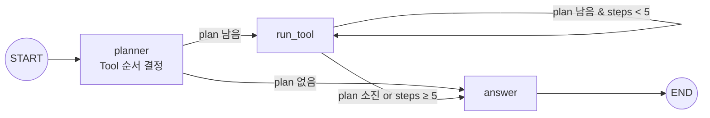

# LangGraph 에이전트와 커스텀 Tool — 여러 도구를 스스로 이어 붙이기

> **한 줄 요약**: 질문 유형에 따라 다른 경로를 타야 해서 선형 체인 대신 LangGraph의 그래프 구조를 썼고, 웹 검색·정형 데이터 API·DB 조회·시각화 Tool을 직접 구현해 **앞 Tool의 결과가 다음 Tool의 입력이 되는** 순차 조합 흐름을 만들었습니다.

---

## 1. 상황

사용자 질문은 형태가 다양했습니다.

- "최근 공급 차질 뉴스 알려줘" → 웹 검색
- "이 유형 뉴스가 과거에 유가를 어떻게 움직였어?" → DB 조회
- "그 뉴스 날짜 전후 가격 그래프 보여줘" → 검색 → 날짜 추출 → API 조회 → 시각화

## 2. 문제

| 문제 | 설명 |
|---|---|
| 선형 체인으로는 분기 불가 | A→B→C 고정 흐름으로는 질문마다 다른 경로를 표현할 수 없음 |
| Tool 간 데이터 전달 | "특정 뉴스 발생일" 같은 중간 결과를 다음 Tool이 써야 함 |
| 무한 루프 위험 | 에이전트가 같은 Tool을 반복 호출할 수 있음 |

## 3. 설계



| 요소 | 결정 |
|---|---|
| **State** | `question`, `plan`, `observations`(reducer로 누적), `context`(Tool 간 공유 데이터), `steps` |
| **라우팅 함수** | State만 보고 다음 노드 이름을 반환하는 **순수 함수** → 테스트·디버깅 쉬움 |
| **루프 탈출** | `steps >= 5`면 강제로 answer 노드로 |
| **Tool 구현** | MCP 서버가 아닌 **직접 구현한 Python 함수**. 웹 검색, 외부 API 정형 데이터, RDB+VDB 동시 조회, 그래프 시각화 4종 |
| **실패 처리** | Tool 실패 시 에러를 관찰로 기록하고, 반복 실패 시 "현재 도구로 답하기 어렵다"는 안전한 응답 |

## 4. 결과

- 에이전트가 "특정 뉴스 발생일의 정형 데이터를 API로 조회 → 시각화 도구로 그래프 생성"처럼 여러 Tool을 **순차적으로 조합**해 결과를 종합하는 흐름까지 구현했습니다.

## 5. 배운 점

- **에이전트 = 상태 + 전이 규칙.** 노드와 엣지로 그려보면 "어디서 무한 루프가 생길 수 있는지", "어디서 실패를 받아야 하는지"가 눈에 보입니다.
- **Tool 사이의 데이터 계약이 중요하다.** 앞 Tool이 무엇을 `context`에 남기는지를 명확히 정하지 않으면 조합이 깨집니다. 이후 문서 AGENT에서 LLM이 JSON만 생성하게 한 설계도 같은 맥락입니다.

---

## 🧪 예제 코드 — `oil_agent_graph.py`

실제 LangGraph(`StateGraph`, `add_conditional_edges`)로 그래프를 구성했습니다.
오프라인으로 실행되도록 **planner 노드의 LLM 판단만 규칙 기반 함수로 대체**했습니다.

```bash
pip install langgraph numpy
python oil_agent_graph.py
```

```
질문: 최근 공급 차질 뉴스가 과거에 준 영향과 가격 그래프 보여줘
  step 1. web_search → '홍해 송유관 공격으로 공급 차질 우려' (day 41)
  step 2. db → 클러스터 '공급 차질', 과거 평균 CAR +2.34%
  step 3. price_api(day=41) → 10일치 가격
  step 4. chart → ▅█▅▂▂▄▃▁▁▁
답변:
  최근 뉴스: 홍해 송유관 공격으로 공급 차질 우려
  같은 유형의 과거 사건은 평균 +2.34% 움직였습니다
  사건일 전후 가격 79.97 → 78.23  ▅█▅▂▂▄▃▁▁▁

질문: 오늘 날씨 어때?
답변:
  현재 도구로 답하기 어려운 질문입니다.
```

## 🎤 면접에서 이렇게 말한다

> "질문마다 다른 경로가 필요해서 LangGraph의 조건부 엣지로 라우팅했고, Tool은 웹 검색·API·DB·시각화 4종을 직접 구현했습니다. 앞 Tool의 결과를 State의 context에 남겨 다음 Tool이 입력으로 쓰게 해서, 뉴스 검색 → 날짜 추출 → 가격 조회 → 그래프까지 이어지는 흐름을 만들었습니다."
