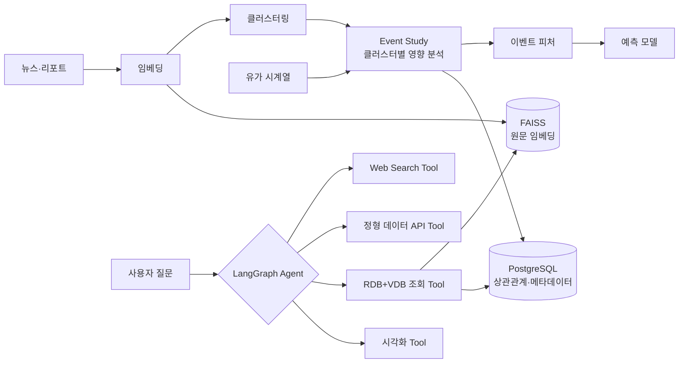

# 04. 브렌트 유가 예측 AI 에이전트

> 뉴스·리포트 같은 **비정형 이벤트**가 유가라는 **정형 데이터**에 미치는 영향을 피처로 만들고,
> 여러 Tool을 스스로 조합해 조회·분석·시각화하는 **LangGraph 에이전트**를 만든 6인 팀 프로젝트입니다.

| 항목 | 내용 |
|---|---|
| 기간 · 형태 | SKALA AI 과정 · 6인 팀 · 2개월 |
| 담당 | 비정형 데이터 파이프라인(Event Study), FAISS + PostgreSQL 듀얼 스토리지, LangGraph 워크플로우와 커스텀 Tool, 프롬프트 엔지니어링 |
| 기술 | Python, LangGraph, PostgreSQL, FAISS, 텍스트 임베딩 클러스터링 |

---

## 🧩 문제

- 유가 관련 정보가 여러 소스에 흩어져 있어, **정보를 모으는 것 자체가 병목**이었습니다.
- 이라크·우크라이나 전쟁 같은 지정학 이슈로 유가가 급변하는 일이 잦아, **변화를 빠르게 포착·반영하는 시스템**이 필요했습니다.

## 🏗️ 아키텍처

## 🎯 성과

- 비정형 데이터 결합 후 **예측 방향성 정확도 약 10%p 개선**
- 여러 Tool을 순차 조합해 스스로 조회 → 분석 → 시각화하는 에이전트 파이프라인 완성

---

## 📚 경험 정리

| # | 경험 | 한 줄 요약 | 예제 코드 |
|---|---|---|---|
| 01 | [Event Study — 비정형 데이터 피처화](./01_EventStudy_비정형데이터_피처화) | 뉴스를 클러스터로 묶고, 클러스터별로 유가가 어떻게 움직였는지를 피처로 | `event_study.py` |
| 02 | [FAISS + PostgreSQL 듀얼 스토리지](./02_FAISS_PostgreSQL_듀얼스토리지) | 의미 검색은 Vector DB, 상관관계·근거 추적은 RDB | `dual_storage.py` |
| 03 | [LangGraph 에이전트와 커스텀 Tool](./03_LangGraph_에이전트와_커스텀Tool) | 질문 유형에 따라 Tool을 골라 순차 조합하는 그래프 | `oil_agent_graph.py` |
| 04 | [Hallucination 회고](./04_Hallucination_회고) | 해결하지 못한 문제를 회고로 남기고, 다음 설계 원칙으로 전환 | `numeric_grounding.py` |

---

## 💡 회고

처음 접하는 도메인에서 **요구사항과 과제 자체를 정의하는 것**이 가장 어려웠습니다.
이 경험이 이후 개인 퀀트 트레이딩 프로젝트, 그리고 현 회사에서 요구사항이 불명확한 상태로 페인포인트를 찾는 업무 방식에 직접적인 도움이 되었습니다.
이 프로젝트에서 "LLM만으로도 유가 방향성 예측이 일정 수준 가능하다"는 논문을 접한 것이 [05. 퀀트 트레이딩](../05_AI_하이브리드_퀀트트레이딩)의 출발점입니다.
