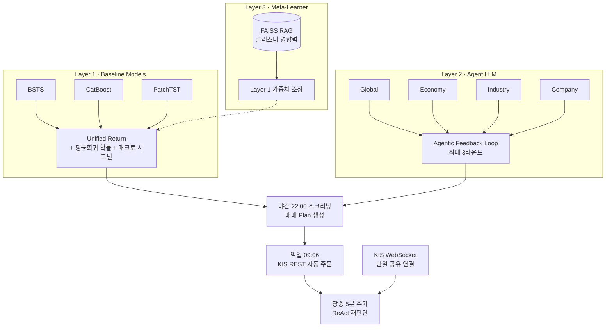

# 05. AI 하이브리드 퀀트 트레이딩 시스템

> 정형 시계열 모델 + 로컬 LLM 에이전트 + 메타 러너를 결합해, **야간 스크리닝부터 익일 자동 주문, 장중 재판단까지 사람 개입 없이 돌아가는** 매매 시스템을 혼자 설계·구현·운영하고 있습니다.

| 항목 | 내용 |
|---|---|
| 기간 · 형태 | 2026.06 ~ 진행 중 · **1인 개발** (기획 · 설계 · 구현 · 운영) |
| 대상 | 한국 주식시장 반도체 후공정 소형주 (SFA반도체 036540, 하나마이크론 067310) + 약 460종목 유니버스 |
| 언어 · 런타임 | Python 3.10+ (asyncio, mypy strict, Pydantic v2) |
| 모델 | BSTS(orbit-ml), CatBoost, PatchTST, KB-BERT, Ollama **KANANA 1.5 8B**(기본), Gemini 2.5 Flash(폴백) |
| 데이터 · 인프라 | TimescaleDB(PostgreSQL), FAISS, KIS REST/WebSocket, Naver Search, FRED, APScheduler, FastAPI |

---

## 🧩 시작 계기와 문제

- 브렌트 유가 프로젝트에서 "LLM만으로도 유가 방향성을 일정 수준 예측할 수 있다"는 논문을 접하고, **실시간으로 동작하는 LLM 기반 판단 서비스**를 직접 만들어 보고 싶었습니다.
- 정형 시계열만으로는 뉴스·이슈로 인한 급변을 포착하기 어렵다 → **정형 + 비정형 융합**, 그리고 **판단부터 실행까지 자동 완결**이 목표.
- 반도체 후공정 소형주를 고른 이유: 상승 국면이라 이벤트·변동성이 잦아 **시그널의 유효성을 빠르게 검증**할 수 있다고 판단. 너무 단조로운 종목은 예측 결과의 의미를 확인하기 어렵습니다.

## 🏗️ 아키텍처

## 🎯 성과

| 지표 | 결과 |
|---|---|
| WebSocket 연결 장애(CRITICAL 로그) | **약 90% 감소** (종목별 연결 → 단일 공유 연결) |
| LLM 출력 파싱 성공률 | LoRA 학습 EXAONE **20% 미만 → KANANA 1.5 8B 그대로 사용 시 90%+** |
| 운영 누적 데이터 | 37일 · 298종목 · **1,157건** 매매 판단 이력 → RAG 컨텍스트로 활용 |
| 모의투자 백테스트 승률 | 약 30% (실전 전환 전 검증 단계) |

---

## 📚 경험 정리

| # | 경험 | 한 줄 요약 | 예제 코드 |
|---|---|---|---|
| 01 | [3-Layer 하이브리드 아키텍처](./01_3Layer_하이브리드_아키텍처) | 숫자 모델 · 뉴스 에이전트 · 메타 러너의 역할 분리와 "조기 진입 · 조기 청산" 전략 | `hybrid_plan.py` |
| 02 | [WebSocket 단일 공유 연결](./02_WebSocket_단일공유연결) | "approval_key당 연결 1개" 제약 → 콜백 딕셔너리 기반 공유 연결 + 자동 재연결 | `shared_websocket.py` |
| 03 | [LoRA 파인튜닝 실패와 RAG 전환](./03_LoRA_파인튜닝_실패와_RAG전환) | 3주치 데이터 LoRA는 형식을 깨뜨렸다 → 베이스 모델 교체 + 매매 이력 few-shot RAG | `fewshot_rag.py` |
| 04 | [KIS 502 토큰 만료 대응](./04_KIS_502_토큰만료_대응) | 401이 아니라 502로 오는 토큰 만료 → 재시도가 아니라 토큰 강제 갱신 | `token_refresh_retry.py` |
| 05 | [장중 ReAct 재판단](./05_장중_ReAct_재판단) | 8쿼리 × 3채널 병렬 검색 + LLM이 검색 여부를 스스로 판단 | `intraday_react.py` |

---

## 🔭 향후 계획

- 8B 모델 단일 GPU → **GPU 2개(장비 2대) 분산**으로 판단 지연 단축
- KIS API 장애 시에도 주문이 유실되지 않도록 **Kafka 등 메시지 큐** 도입 검토 (내결함성)
- Layer 3 Meta-Learner 완전 구현

## 💡 회고

- **"로컬 LLM 우선, 클라우드는 장애 대비 폴백"** 이라는 운영 원칙을 스스로 세우고 검증했습니다. 비용 0, 매매 전략 데이터 외부 유출 없음.
- 브렌트 프로젝트에서 익힌 정형 + 비정형 결합을, **실제로 매일 돌아가는 시스템**으로 확장·완결한 경험입니다.
- 외부 API 문서와 실제 동작이 다른 경우(WebSocket 포트, 502 토큰 만료)를 여러 번 겪으며, **문서보다 공식 예제 코드와 실제 응답 로그를 먼저 확인**하는 습관이 생겼습니다.
