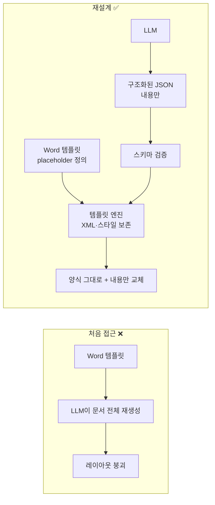

# 06. MID · 문서 형식 유지 문서 작성 AGENT

> 사내 PAD(Part Approval Document) 같은 정형 보고서를 자동으로 작성하려다, "LLM에게 Word 문서를 통째로 다시 만들게 하면 된다"는 접근이 **레이아웃을 무너뜨린다**는 것을 겪고,
> **내용(Content)은 LLM이, 형식(Layout)은 코드가** 맡는 구조로 재설계한 프로젝트입니다.

| 항목 | 내용 |
|---|---|
| 기간 · 형태 | 2026.07 ~ · **단독 진행** (사내 SW 개발 담당 1인) |
| 대상 문서 | PAD(Part Approval Document), 계약서 등 정해진 Word 양식의 보고서 |
| 기술 | Python, python-docx 기반 Jinja 스타일 템플릿 엔진, qwen2.5-vl-7b, qwen3.6-35b, GPT-OSS-120B, OnlyOffice + Vue(검토) |

---

## 🧩 문제

- PAD 같은 정형 보고서는 기존 데이터·규격 내용을 반복해서 찾아 정해진 양식에 옮겨 써야 합니다.
- 엔지니어가 **실제 엔지니어링보다 문서 편집에 더 많은 시간**을 쓰고 있었습니다.

## 🔄 구조적 판단의 전환

## 🎯 성과

- placeholder 기반 템플릿 엔진을 실제 동작 수준까지 구현
- **실제 계약서 · PAD 양식에서 폰트 · 정렬 · numbering · 머리글/바닥글을 그대로 유지한 채 내용만 수정** 가능한 수준 도달
- 문제 정의 → 설계 → 구현 전 과정을 단독 수행

---

## 📚 경험 정리

| # | 경험 | 한 줄 요약 | 예제 코드 |
|---|---|---|---|
| 01 | [LLM 문서 재생성 실패 분석](./01_LLM_문서재생성_실패분석) | 무엇이 깨졌는지 9가지로 분류하고, "생성 방식 자체의 한계"라고 결론 | `layout_diff.py` |
| 02 | [Content / Layout 분리 템플릿 엔진](./02_Content_Layout_분리_템플릿엔진) | LLM은 JSON만, 코드는 원본 XML·스타일을 보존한 채 값만 주입 | `docx_template_engine.py` |
| 03 | [역할 분리 에이전트 설계](./03_역할분리_에이전트_설계) | Report / Layout / Verification 에이전트로 책임을 나눔 | `role_agents.py` |

---

## 💡 회고

- **Generative Model에게 "형식이 있는 결과물" 전체를 맡기면 안 된다.** 결정적인 부분(레이아웃)과 비결정적인 부분(내용 생성)을 분리해야 합니다. 이 원칙은 실패를 통해 몸으로 배웠습니다.
- 이 경험과 문서 안의 참조 구조를 다뤄본 경험이 [07. ECSS 규격 그래프DB 파이프라인](../07_MID_ECSS규격_그래프DB_파이프라인)의 출발점이 되었습니다.
- 자동 생성 문서를 웹에서 미리보고 고칠 수 있도록 **OnlyOffice + Vue** 연동을 검토했습니다. 단순 미리보기(docx-preview)가 아니라 실제 편집이 필요해서 OnlyOffice가 맞다고 판단했습니다.

## ➡️ 이후

이 프로젝트의 템플릿 엔진과 역할 분리는 [09. PAD 에이전트 플랫폼](../09_MID_PAD_에이전트_플랫폼)에서 **모델 호출 없는 템플릿 렌더 단계**와 **결정적 STEP 파이프라인**으로 발전했습니다.
