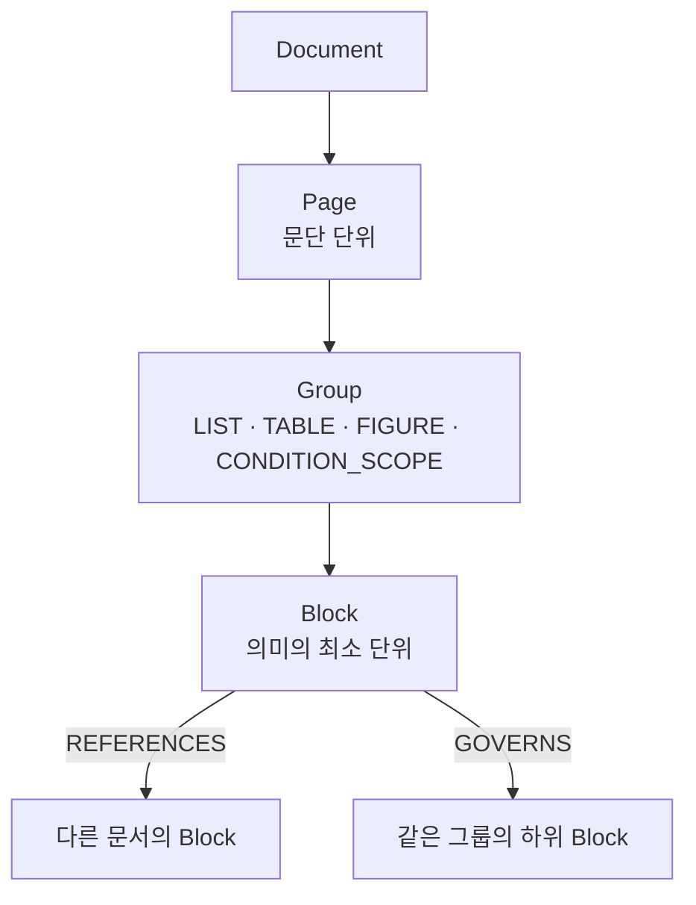

# 아키텍처

## 1. 파이프라인

```
일반 RAG :  PDF → Chunk → Embedding → VectorDB → LLM

이 프로젝트:
PDF → Layout/Region → Atomic Block → Metadata → Embedding → Vector Search
                                                          ↘
                                         Graph Relation → Source Trace → LLM
```



---

- 이전 문서: [프로젝트 개요](00-overview.md)
