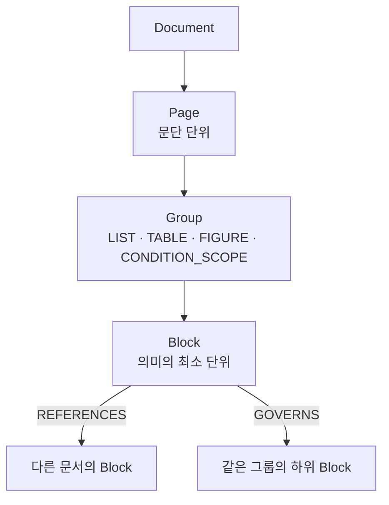

# 07. MID · ECSS 우주 규격 문서 그래프DB 데이터 파이프라인

> ECSS / ESCC / MIL 규격 문서는 조항끼리, 문서끼리 **참조가 극도로 많습니다.** 청크로 잘라 Vector Search만 하는 일반 RAG로는 참조가 끊기는 순간 의미가 무너집니다.
> 그래서 규격 문서를 **의미의 최소 단위(Atomic Block)** 로 쪼개고, Block 사이의 참조를 **그래프**로 연결하는 데이터 파이프라인을 설계·구현하고 있습니다.

| 항목 | 내용 |
|---|---|
| 기간 · 형태 | 2026.07 ~ 진행 중 · **단독 진행** |
| 대상 | ECSS / ESCC / MIL 규격 문서, ESCC Specification List |
| 기술 | Python, PDF Parsing, JSON Schema(버전 관리), PostgreSQL + Apache AGE(그래프), Vector DB / Embedding, BM25 |

---

## 🧩 문제

| 일반 RAG | 규격 문서에서 생기는 일 |
|---|---|
| 문서를 고정 길이 청크로 자름 | "다음 조건을 만족해야 한다:"와 그 아래 항목이 다른 청크로 분리 → **의미 붕괴** |
| 유사도로 청크 검색 | "이 조항이 참조하는 다른 문서의 조항"을 따라갈 수 없음 |
| Revision 개념 없음 | PAD 같은 승인 문서에 필수인 **정확한 Revision**을 보장 못 함 |

## 🏗️ 파이프라인

```
일반 RAG :  PDF → Chunk → Embedding → VectorDB → LLM

이 프로젝트:
PDF → Layout/Region → Atomic Block → Metadata → Embedding → Vector Search
                                                          ↘
                                         Graph Relation → Source Trace → LLM
```



## 🎯 성과

- ECSS-P-00 문서에서 **388개 Block** 실제 추출
- 스키마 **v3 → v4** 개선: 31개 그룹, `GOVERNS` 관계, 리드인 주입, `derived_fields` 분리, 스키마 거버넌스 메타 선언
- ESCC Specification List **645건 → 641건 canonical record**, `schema_version 1.1`로 변환 완료
- Graph DB 노드 8종 · 엣지 7종 설계

---

## 📚 경험 정리

| # | 경험 | 한 줄 요약 | 예제 코드 |
|---|---|---|---|
| 01 | [4계층 Atomic Block 스키마](./01_4계층_AtomicBlock_스키마) | 불확실성(`confidence`, `requires_review`)과 근거(`sources`)를 스키마에 넣음 | `block_schema.py` |
| 02 | [스키마 v3에서 v4로](./02_스키마_v3에서_v4로) | 리드인 문맥 손실 · 그룹 부재 · 필드 혼재를 점진적으로 개선 | `migrate_v3_to_v4.py` |
| 03 | [ESCC 메타데이터 정규화](./03_ESCC_메타데이터_정규화) | 이슈 단위 645건을 문서 단위 641건으로, 검색·그래프용 필드 설계 | `escc_canonicalize.py` |
| 04 | [그래프 노드 · 엣지 설계](./04_그래프_노드엣지_설계) | "이 부품군에 적용되는 규격의 최신 Revision은?"을 그래프 탐색으로 | `spec_graph.py` |

---

## 📍 현재 상태

- ✅ Block 추출 파이프라인과 스키마 구현 · 반복 개선 중 (v4)
- 🔄 Graph DB 실제 적재, Revision Verification 자동화, 전체 RAG 파이프라인 통합은 설계 · 진행 중

## 💡 회고

- 문서 간 참조와 Revision이 핵심인 도메인에서는 **Vector Search + Metadata + Graph + Revision + Source Trace**를 함께 결합해야 합니다.
- 스키마를 처음부터 완성하려 하지 않고 **실제 데이터로 돌려보며 v3 → v4로 진화**시켰습니다.
- [06. 문서 AGENT](../06_MID_문서형식유지_작성AGENT)의 "Content / Layout 분리" 통찰이 "Atomic Block / Graph" 구조로 확장된 프로젝트입니다.
