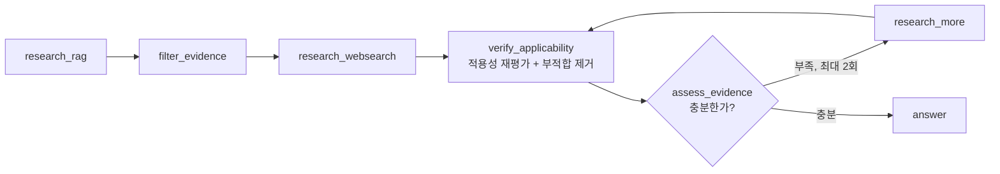

# 근거 적용성 검증 루프 — "찾은 근거가 이 부품에 해당하는가"

> **한 줄 요약**: 기술 질문 분기에서 근거를 찾은 뒤 바로 답하지 않고, **재검색 루프 안쪽에서 매 라운드 "이 근거가 지금 질문한 부품에 적용되는가"를 다시 평가**해 부적합 근거를 실제로 제거했습니다. 근거가 부족하면 최대 2회까지 추가 검색하고, Deep Search 모드에서는 **사람이 근거를 먼저 고른 뒤** 답변을 만들고, 답변도 사람이 승인해야만 지식으로 저장됩니다.

---

## 1. 상황

- 일반 채팅은 질문 분야를 4갈래(기술 · 사내 정책 · 일반 · 사내 과제)로 나눠 처리합니다.
- 기술 질문은 "사내 RAG → 근거 필터 → 웹 검색"으로 근거를 모읍니다.

## 2. 문제

| 문제 | 예시 |
|---|---|
| **관련은 있지만 적용되지 않는 근거** | "세라믹 커패시터 규격"을 물었는데 탄탈 커패시터 조항이 상위에 검색됨 |
| 적용성을 한 번만 따지면 | 추가 검색으로 들어온 새 근거는 검증 없이 답변에 섞임 |
| 계산은 했는데 화면에 안 보임 | 적용성 결과를 계산했지만, 화면이 읽는 필드와 **키가 맞지 않아** 기록되지 않던 버그 |

## 3. 설계



| 결정 | 이유 |
|---|---|
| `verify_applicability`를 **루프 안쪽**에 | 새로 들어온 근거도 매 라운드 같은 기준으로 검증 |
| 부적합 근거는 **실제로 삭제** | "부적합" 표시만 하면 답변 생성 단계에서 다시 섞임 |
| 추가 검색 **최대 2회** | 무한 검색 방지, 응답 시간 상한 |
| **Deep Search**: 근거 후보를 SSE로 보내고 사람이 선택 → 그다음 답변 | 고위험 질문은 근거 선택 자체를 사람이 |
| 답변 **승인 후에만 DB 저장** | 검증 안 된 답변이 다음 답변의 근거가 되는 오염 방지 |

## 4. 버그에서 배운 것 — "계산한 값이 화면이 읽는 필드에 연결되었는가"

- 적용성 결과를 근거마다 계산했지만, 결과를 근거에 붙일 때 쓰는 키(위치 정보)가 서로 달라 **join이 0건**이었습니다. 에러는 없었고, 화면에는 "적용성 미기록"만 보였습니다.
- 그 뒤로 노드를 추가할 때는 **"이 노드의 출력이 최종 응답의 어떤 필드로 가는가"를 테스트로 고정**하는 것을 개발 표준에 넣었습니다.

## 5. 결과

- 답변 근거에는 **적용성 판정을 통과한 것만** 남고, 각 근거에 판정 이유가 붙습니다.
- 사람 승인을 거친 답변만 다음 질문의 지식이 됩니다.

## 6. 배운 점

- **검증은 루프의 입구가 아니라 루프 안에 둔다.** 데이터가 들어오는 모든 경로를 같은 검증이 지나가야 합니다.
- **조용한 실패가 가장 위험하다.** 예외 없이 0건이 되는 join은 테스트 없이는 찾을 수 없습니다.

---

## 예제 코드 — `evidence_loop.py`

근거 검색 → 적용성 검증 → 충분성 평가 → 추가 검색(최대 2회) 루프를 재현합니다.
마지막에 **"모든 최종 근거에 적용성 판정이 붙어 있는가"** 를 검사하는 테스트를 넣어, 키 불일치 버그를 재현하고 잡아냅니다.

```bash
python evidence_loop.py
```
