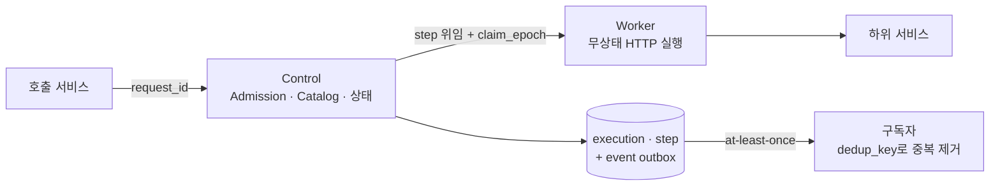

# Outbox와 Fencing — 서비스 간 실행을 믿을 수 있게 만들기

> **한 줄 요약**: 서비스끼리 직접 호출하던 구조를 **Control(무엇을 실행할지 · 상태) / Worker(실제 호출) / Resolver(데이터)** 로 나누는 오케스트레이션 플랫폼을 설계했습니다. 핵심은 네 가지입니다. **같은 요청 ID는 다시 실행하지 않는다(멱등)**, **상태 변경과 이벤트 기록은 한 트랜잭션(Transactional Outbox)**, **늦게 돌아온 결과는 epoch로 차단(Fencing)**, **재시도는 실패한 step만**.

---

## 1. 상황

- chatbot이 규칙 서비스 · 렌더 서비스 · 검색 서비스 · 규격 분석 서비스를 **직접** 호출하고 있었습니다.
- 호출마다 재시도 · 타임아웃 · 인증 방식이 달랐고, "이 PAD 문서는 어떤 호출들을 거쳐 만들어졌나"를 한 곳에서 볼 수 없었습니다.

## 2. 문제

| 문제 | 실제로 생길 수 있는 일 |
|---|---|
| 클라이언트 재전송 | 같은 렌더 요청이 두 번 실행 → 문서 두 개 |
| 상태 저장 후 이벤트 발행 전에 죽음 | 상태는 "완료"인데 아무도 모름 (또는 그 반대) |
| 타임아웃 후 재시도했는데 **원래 요청이 늦게 성공** | 늦게 온 옛 결과가 새 결과를 덮어씀 |
| 5단계 중 4단계에서 실패 | 처음부터 다시 실행 → 비용 · 시간 낭비, 부작용 중복 |

## 3. 설계



| 장치 | 동작 |
|---|---|
| **Idempotency** | 같은 `request_id`가 다시 오면 새로 실행하지 않고 기존 결과 반환 |
| **Action Catalog** | `(서비스, action)`마다 endpoint · timeout · 재시도 · 요청/응답 JSON Schema 계약. 계약 내용의 **digest**를 계산해 같은 버전을 다른 내용으로 재등록하면 거부 |
| **Transactional Outbox** | step 상태 변경과 `event` 기록을 **같은 트랜잭션**에. 별도 루프가 outbox를 읽어 발행(at-least-once) |
| **dedup_key / ordering_key** | 모든 이벤트에 필수. 구독자는 중복을 버리고, 같은 실행의 이벤트는 순서 보장 |
| **Fencing (claim_epoch)** | step을 Worker에 맡길 때마다 epoch 증가. 결과 보고 시 epoch가 현재와 다르면 **거부** |
| **부분 재시도** | `retry`는 FAILED step만 다시 실행, SUCCEEDED는 결과 재사용 |
| **상태 집계** | 전부 성공 → SUCCEEDED, 전부 실패 → FAILED, 섞이면 **PARTIAL_SUCCESS** |
| **취소** | 취소 의도를 DB에 먼저 기록 → Worker에는 best-effort 신호 → 늦게 온 결과는 fencing이 차단 |

**Kafka는 아직 도입하지 않았습니다.** 현재 규모에서는 Postgres outbox로 충분하다고 판단했고, 도입 기준은 별도로 정하기로 했습니다.

## 4. 결과

- 근거 검색, 웹 문서 수집, 문서 렌더 등을 Action · DAG 템플릿으로 카탈로그에 등록
- 실행 · step · 이벤트 이력이 남아 **감사(audit) replay API**로 한 요청의 전 과정을 다시 볼 수 있음
- 기존 직접 호출은 **플랫폼 완성 후 한 번에 전환**하기로 결정 (부분 전환 시 두 경로가 공존하는 위험 회피)

## 5. 배운 점

- **분산 시스템의 "한 번만"은 "멱등 + 중복 제거"로 만든다.** 메시지를 정확히 한 번 보내는 것보다, 여러 번 와도 결과가 같게 만드는 것이 현실적입니다.
- **시간은 믿을 수 없고 순서는 번호로 만든다.** "늦게 온 응답"은 타임아웃으로 막을 수 없고 epoch 비교로만 막힙니다.
- **새 인프라(Kafka)는 필요가 증명될 때 들인다.** 1인 유지보수 환경에서 DB 하나로 해결할 수 있으면 그게 정답입니다.
- 퀀트 트레이딩의 502 토큰 문제에서 배운 "재시도는 상태를 바꿀 때만 의미 있다"가 여기서 **"실패한 step만 재시도"** 로 이어졌습니다.

---

## 예제 코드 — `outbox_fencing.py`

SQLite로 Control의 핵심 동작을 재현합니다.
① 같은 request_id 재전송 → 재실행 안 됨 ② 상태 + 이벤트 한 트랜잭션 ③ 타임아웃 후 재할당된 step에 **옛 Worker 결과가 늦게 도착 → 거부** ④ 실패 step만 재시도 ⑤ outbox 중복 발행 → 구독자가 dedup.

```bash
python outbox_fencing.py
```
