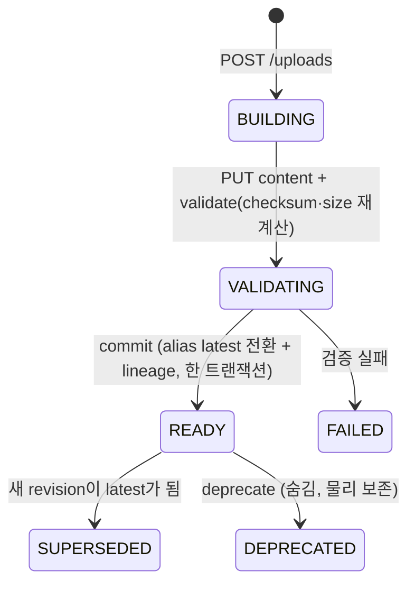

# Artifact Resolver 수명주기 — "어디에 있는지"를 서비스가 몰라도 되게

> **한 줄 요약**: 서비스마다 사내 파일 서버 경로 · DB 테이블 · 벡터 컬렉션을 직접 알고 읽고 쓰던 구조를, 모든 데이터를 `artifact://` 논리 주소로 등록 · 조회하는 **Artifact Resolver**로 바꾸는 설계를 했습니다. 업로드는 **BUILDING → VALIDATING → READY** 단계를 거쳐야만 다른 서비스에 보이고, 권한이 없으면 **존재 자체를 404로 숨기며**, 선언되지 않은 데이터 종류는 **기본 거부**합니다.

---

## 1. 상황

- 문서 렌더 결과(DOCX/PDF), OCR 결과, 임베딩, 규격 블록이 사내 파일 서버 · DB · 벡터 저장소에 흩어져 있었습니다.
- 서비스가 서로의 **물리 경로를 직접 알고** 있어서, 저장 위치를 바꾸면 여러 서비스를 함께 고쳐야 했습니다.
- "이 PAD 문서는 어떤 규격 블록과 어떤 모델 실행에서 나왔나"(계보, lineage)를 추적할 수 없었습니다.

## 2. 문제

| 문제 | 위험 |
|---|---|
| 쓰는 도중인 파일을 다른 서비스가 읽음 | 반쯤 만들어진 문서 · 손상된 데이터 사용 |
| `latest`를 덮어쓰다 실패 | 이전 정상본도 잃음 |
| 권한 없는 서비스가 "없음(404)"과 "금지(403)"를 구분 | 존재 여부 자체가 정보 유출 |
| 다른 서비스 이름으로 등록 | 소유자 사칭 |

## 3. 설계

| 규칙 | 내용 |
|---|---|
| **commit 전에는 보이지 않음** | alias · URI 조회로는 BUILDING / VALIDATING / FAILED가 절대 나오지 않음 |
| **latest 전환은 원자적** | 새 revision이 READY가 되는 순간 같은 트랜잭션에서 alias 전환 → 실패해도 이전 latest 유지 |
| **존재 숨김** | 소유 서비스가 아니고 권한도 없으면 403이 아니라 **404** |
| **ACL 기본 거부** | 명시 ACL 우선, 없으면 "기본 공개 범위가 선언된 종류"만 허용, **미선언 종류는 거부** |
| **자기주장 금지** | 조회 범위를 `?scope=` 같은 파라미터로 받지 않고, **호출자 identity**의 실제 소속으로만 판단 |
| **소유자 사칭 차단** | `owner_service`는 호출자 identity와 같아야 함. 대행 권한(proxy)이 있는 Control만 예외 |
| **lineage도 ACL** | 계보 조회 시 조상 · 자손을 각각 권한으로 필터 — 권한 없는 부모는 존재조차 노출 안 함 |
| **물리 주소는 Resolver만** | 서비스는 `artifact://`만 알고, 사내 파일 서버/DB/Object Storage 경로 해석은 Resolver adapter가 담당 |
| **삭제는 2단계** | deprecate(숨김) → admin delete(물리 회수). 여러 revision이 공유하는 blob은 마지막 참조일 때만 삭제 |

## 4. 결과

- 격리된 PostgreSQL을 띄워 수명주기 · ACL 테스트를 작성
- 기존에 유일하게 동작하던 `artifact://` 구현(문서 렌더 서비스의 저장 모듈)을 일반화할 1차 대상으로 정함
- 아직 남은 것: 기존 서비스 실제 통합 · 마이그레이션, 벡터 저장소 adapter, 보관 · 삭제 승인 정책

## 5. 배운 점

- **"보이는 것"을 상태로 정의한다.** 쓰는 중 / 검증 중 / 사용 가능을 상태 머신으로 만들면, "언제 읽어도 되는가"가 코드로 보장됩니다.
- **보안의 기본값은 거부다.** 선언되지 않은 것은 허용하지 않고, 존재 여부도 정보라는 관점으로 404를 씁니다.
- **호출자가 말하는 것보다 호출자가 누구인지를 믿는다.** 범위 · 소유자를 요청 파라미터에서 받지 않는 것이 사칭을 막는 가장 단순한 방법이었습니다.
- 07 ECSS 프로젝트의 "원본으로 역추적" 원칙이 여기서 **lineage**로 시스템 전체에 확장됐습니다.
