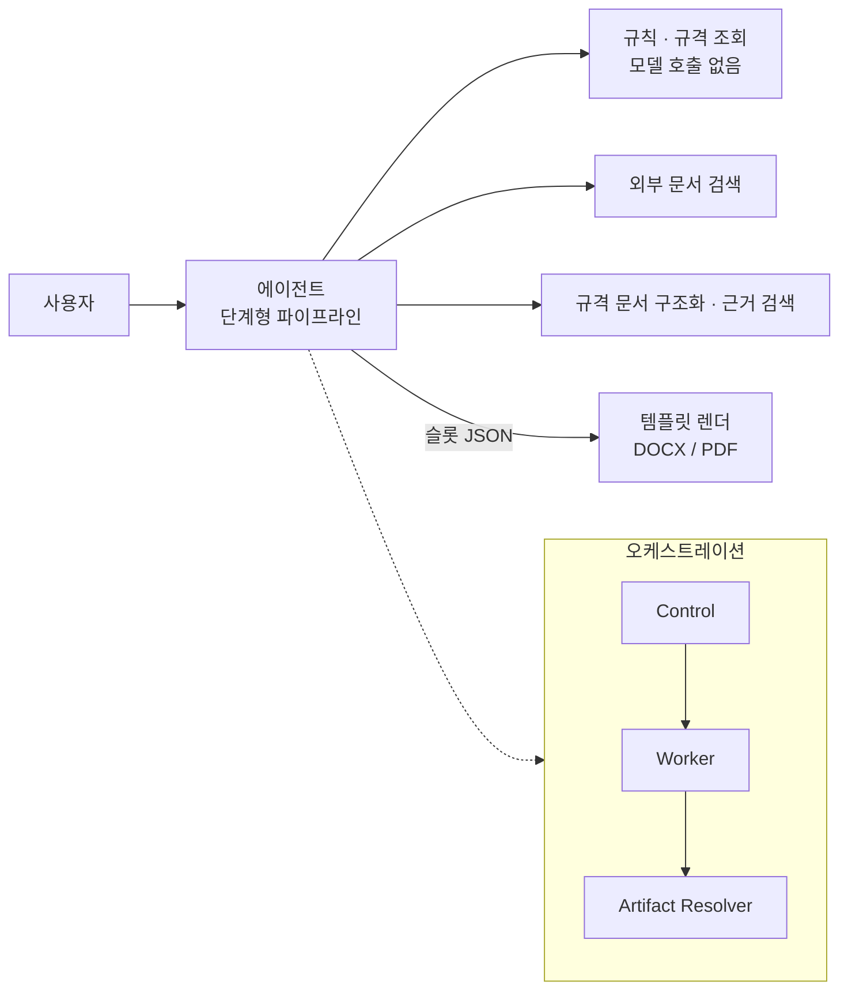

# 09. MID · PAD 에이전트 플랫폼

> 부품 승인 문서(PAD, Parts Approval Document)를 자동으로 작성하는 사내 에이전트를,
> 문서 템플릿 실험([06](../06_MID_문서형식유지_작성AGENT))과 규격 구조화 실험([07](../07_MID_ECSS규격_그래프DB_파이프라인))에서 출발해 **여러 서비스로 구성된 운영 플랫폼**으로 확장한 프로젝트입니다.
> 회사 내 SW 개발 담당이 1인이라 설계 · 판단 · 검증을 맡았고, 구현은 AI 코딩 에이전트와 협업했습니다.

| 항목 | 내용 |
|---|---|
| 기간 | 2026.09 ~ 진행 중 |
| 형태 | 사내 프로젝트 · 1인 개발 (AI 코딩 에이전트 협업) |
| 주요 기술 | Python, FastAPI, LangGraph, PostgreSQL(pgvector · Apache AGE), vLLM 기반 로컬 모델 서빙, Vue 3, Kubernetes · GitOps(Jenkins · ArgoCD) |

> 회사 자산 보호를 위해 내부 서비스 구성 · 인프라 · 수치 · 소스 코드는 싣지 않았습니다. 이 문서는 **제가 내린 설계 판단과 배운 점**을 일반화해 정리한 것이고, 예제 코드는 모두 가상 데이터로 직접 재현한 것입니다.

---

## 🧩 문제

승인 문서 한 건을 쓰려면 엔지니어가 부품 분류 → 데이터시트 확인 → 사내 코드 확정 → 적용 규격과 개정 계보 추적 → 품질 등급 · 시험 항목 결정 → 정해진 양식에 옮겨 쓰기를 모두 손으로 해야 했습니다.

여기에는 **틀리면 안 되는 판정**과 **LLM이 도와줄 수 있는 일**(분류 보조, 요약, 후보 추천)이 섞여 있었습니다.

## 🏗️ 구조 (개념도)

## 📐 스스로 세운 설계 원칙

1. **LLM은 판정에 쓰지 않는다.** 분류 보조 · 요약 · 후보 추천 · 값 추출에만 쓰고, 판정은 코드와 승인된 데이터가 결정한다.
2. **LLM은 텍스트를 다시 쓰지 않고 경계 · 분류 · 선택만 판단한다.** (인용 신뢰성)
3. **근거가 없으면 추측하지 않는다.** 미확정 상태를 그대로 보여주고 사람에게 넘긴다.
4. **서비스는 서로의 DB를 직접 읽지 않는다.** 필요한 기능은 API 계약으로만.
5. **부분 실패가 전체를 막지 않는다.** 배치는 항목 단위로 실패를 격리한다.
6. **사고는 규칙과 검사기로 남긴다.**

---

## 📚 경험 정리

| # | 경험 | 한 줄 요약 | 예제 코드 |
|---|---|---|---|
| 01 | [LLM은 판정하지 않는다 — 결정적 단계](./01_LLM은_판정하지_않는다_결정적_STEP) | LLM은 후보만, 확정은 테이블. 모든 칸에 근거와 상태 | `deterministic_steps.py` |
| 02 | [LLM은 경계만 판단 — 청킹](./02_LLM은_경계만_판단_청킹) | 텍스트를 다시 쓰지 않고 자를 위치만 고르게 해서 인용을 보존 | `boundary_chunking.py` |
| 03 | [근거 적용성 검증 루프](./03_근거_적용성_검증_루프) | 재검색 루프 안에서 매번 적용성을 다시 따지고, 부적합 근거는 실제로 제거 | `evidence_loop.py` |
| 04 | [멱등 배치와 상태 분리](./04_멱등_배치와_상태_분리) | 원장 상태와 RAG 상태를 분리, 복원 시 좌초 사고에서 배운 것 | `nas_scan_state.py` |
| 05 | [CronJob 사고를 검사기로](./05_CronJob_사고를_검사기로) | 타임존 · 라벨 누락 사고를 규칙으로 바꿔 린터로 만듦 | `cronjob_lint.py` |
| 06 | [Outbox와 Fencing — 실행 제어](./06_Outbox와_Fencing_실행제어) | 상태 변경과 이벤트를 한 트랜잭션에, 늦게 온 결과는 epoch로 차단 | `outbox_fencing.py` |
| 07 | [Artifact Resolver 수명주기](./07_Artifact_Resolver_수명주기) | 검증 · 확정 전에는 보이지 않고, 권한 없으면 존재도 숨김 | `artifact_lifecycle.py` |
| 08 | [Fail-Closed 호출 경계](./08_Fail-Closed_호출_경계) | 경로 정규화 후 allowlist, 계약 digest 불일치면 실행 거부 | `call_boundary.py` |
| 10 | [Control Plane 단계적 전환과 운영 사고](./10_Control_Plane_단계적_전환과_운영사고) | shadow → 안전망 → strict → intent, 안전망 제거 날 드러난 숨은 라우트 | `staged_migration.py` |
| 11 | [가짜 유사도 점수 버그](./11_가짜_유사도_점수_버그) | "점수 없음"을 1.0으로 찍어 진짜 근거가 밀려난 문제 | `evidence_cap.py` |
| 12 | [턴 사이 State 누수](./12_턴_사이_State_누수) | 체크포인터가 지난 턴 값을 이어받는 문제 → 턴 시작 리셋 | `turn_state_leak.py` |
| 13 | [AI 협업 개발 프로세스](./13_AI_협업_개발_프로세스) | 기억 없는 코딩 에이전트를 위한 plan / task / memory 계층과 hook | `memory_cycle.py` |

---

## 🔗 앞 프로젝트와의 연결

| 이전 실험 | 플랫폼에서의 모습 |
|---|---|
| [06](../06_MID_문서형식유지_작성AGENT) Content / Layout 분리 | 템플릿 렌더 단계에는 모델 호출이 없고, 슬롯 JSON을 치환하기만 함 |
| [06](../06_MID_문서형식유지_작성AGENT) Report / Verification 역할 분리 | 단계형 파이프라인 + 슬롯마다 근거 · 상태 |
| [07](../07_MID_ECSS규격_그래프DB_파이프라인) Atomic Block · 관계 그래프 | 규격 문서 구조화와, 승인된 규격 관계만 판정에 쓰는 규칙 조회 |
| [05](../05_AI_하이브리드_퀀트트레이딩) 외부 API 제약 · 재시도 설계 | 오케스트레이션: 실패한 단계만 재시도, fencing, outbox |

## 💡 회고

- **설계 문서와 실제 코드는 생각보다 많이 다르다.** 그래서 문서를 쓸 때는 "구현됨 / 설계만 / 미배포"를 구분하고, 충돌하면 코드를 기준으로 삼았습니다.
- **사고는 규칙이 되어야 한다.** 타임존, 라벨 누락, 상태 리셋 누락 같은 사고를 개인의 기억이 아니라 표준과 검사 코드로 남겼습니다.
- **LLM을 쓰는 범위를 좁힐수록 시스템을 믿을 수 있게 된다.** 이 프로젝트에서 가장 중요한 결정은 "LLM을 어디에 쓰지 않을 것인가"였습니다.
