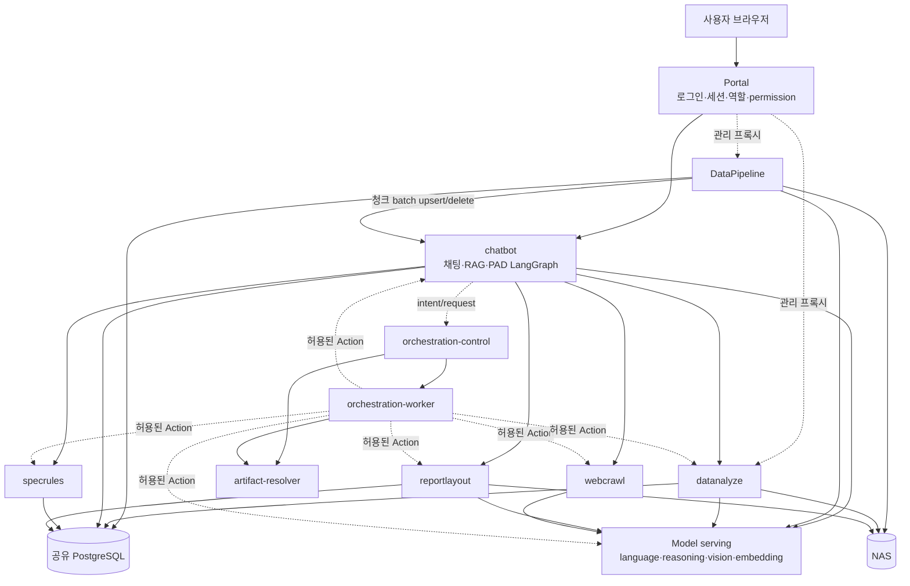
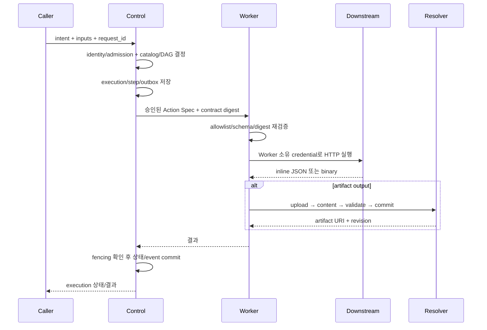
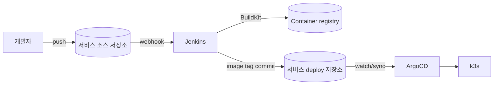

# 시스템 아키텍처

## 1. 아키텍처 목표

이 플랫폼의 목적은 “AI가 문서를 대신 작성한다”가 아니라, 여러 데이터 원천과 규칙을 이용해 **사람이 감사할 수 있는 승인 문서 생성 과정**을 만드는 것이다. 따라서 아키텍처는 다음 요구를 중심으로 설계됐다.

- 모든 문서 필드를 근거 문서·규칙·사용자 입력으로 역추적할 수 있어야 한다.
- LLM의 비결정성과 규칙 판정을 분리해야 한다.
- 한 서비스의 장애나 한 문서의 실패가 전체 배치를 막지 않아야 한다.
- 장시간 작업은 HTTP 요청보다 오래 살아남고 재시작 후 복구돼야 한다.
- 서비스 자격증명과 최종 사용자 권한을 분리해야 한다.
- 템플릿, 데이터 원천, 실행 backend를 호출자 재배포 없이 바꿀 수 있어야 한다.

## 2. 전체 논리 아키텍처



실선은 기존 직접 연동 또는 데이터 경로이고, 점선은 Control Plane을 통한 전환 경로다. Portal, DataPipeline, model serving, 공용 인프라는 업무 서비스는 아니지만 전체 시스템을 이해하려면 반드시 경계에 포함해야 한다.

## 3. 계층별 구성

### 3.1 Experience와 Identity 계층

Portal은 사람 인증의 기준이다. 브라우저 세션, 사용자, 부서, 역할과 세부 permission을 관리하고 서비스 진입점과 관리자 프록시를 제공한다. 서비스는 다음 두 종류의 identity를 구분한다.

- **user identity**: 어느 사용자가 어떤 부서·권한으로 요청했는가
- **workload identity**: 어느 서비스가 어느 action을 호출할 수 있는가

사용자 세션 쿠키를 모든 내부 서비스에 그대로 전달하거나, 하나의 공유 Bearer를 사람 권한처럼 해석하지 않는다. Control 경로에서는 단명 delegation token으로 검증된 user context를 전달하고, service credential은 별도 admission 정책으로 평가한다.

### 3.2 Agent와 Application 계층

`chatbot`에는 서로 연결되지만 다른 수명주기를 가진 흐름이 있다.

- 일반 기술 Q&A와 deep research
- 일반 문서 작성
- PAD 검색 그래프와 작성 그래프
- 사용자 근거 선택과 문서 수정 같은 HITL
- 비동기 run 및 SSE 상태 전파

LangGraph checkpoint는 대화 세션과 문서 실행을 HTTP 연결 수명에서 분리한다. PAD는 검색과 작성을 두 그래프로 나눠, 근거 수집 후 검토·보완한 상태에서 렌더링을 재개할 수 있다.

### 3.3 Knowledge와 Rule 계층

| 서비스 | 소유하는 판단/데이터 | 소유하지 않는 것 |
|---|---|---|
| `specrules` | 코드표, 규격 적용성 edge, 품질·screening 기본값 | 원문 OCR, 자유 웹 검색 |
| `datanalyze` | 규격 원문 OCR 결과, KG, 검색용 requirement block | 최종 PAD 판정 |
| `webcrawl` | 외부 검색·fetch·공급자 adapter·도메인 평판 | 내부 규칙의 진실값 |
| DataPipeline | NAS 자산 원장, RAG 추출·청킹·전파 상태 | 기술 규격의 의미 판정 |
| `chatbot` | 질의 분해, 근거 결합, 사용자/문서 상태 | 다른 서비스의 canonical 데이터 |

이 경계가 필요한 이유는 “검색 결과가 있다”와 “업무 규칙상 적용된다”가 전혀 다른 명제이기 때문이다.

### 3.4 Rendering 계층

`reportlayout`은 공통 슬롯 의미를 물리 템플릿으로 투영한다. 템플릿 계약 조회, 필수 필드와 타입 검증, golden/example 관리, DOCX/PDF 렌더링을 맡는다. PAD agent는 템플릿의 셀 좌표나 문서 내부 구조를 알 필요가 없고, 렌더러는 슬롯의 업무 판정을 다시 수행하지 않는다.

### 3.5 Control, Execution, Data Runtime 계층



Control은 실행의 의미와 상태를 소유하지만 다운스트림 토큰을 소유하지 않는다. Worker는 토큰과 endpoint allowlist를 소유하지만 장기 실행 상태를 소유하지 않는다. Resolver는 물리 저장 위치를 소유하지만 업무 DAG를 알지 않는다. 이 분리는 침해 범위와 결합도를 줄인다.

## 4. 런타임 요청 흐름

### 4.1 사용자 요청과 SSE

1. 사용자가 Portal을 통해 `chatbot` API를 호출한다.
2. API가 세션 소유권과 permission을 확인하고 입력을 저장한다.
3. run registry에 `run_id`, queue와 취소 event를 만들고 그래프를 background task로 시작한다.
4. API는 202와 `run_id`를 반환한다.
5. 브라우저가 SSE stream을 열어 node/evidence/field/done/error 이벤트를 받는다.
6. 그래프는 checkpoint와 최종 답변·필드·근거를 DB에 기록한다.
7. stream 조회와 취소에서도 세션 소유권을 다시 확인한다.

현재 run queue가 프로세스 메모리에 있는 경로는 다중 replica 확장 전에 외부 조정 계층이 필요하다.

### 4.2 PAD 생성

상세 STEP은 [06-pad-pipeline.md](06-pad-pipeline.md)를 참고한다.

```text
layout contract
  → STEP 0~2 + evidence tree
  → checkpoint/HITL
  → STEP 3·4·6·7·11
  → slot validation
  → DOCX/PDF render
  → 사람 승인·서명
```

### 4.3 장시간·다단계 실행

Control은 `request → execution → execution_step`으로 상태를 영속화한다. DAG 의존성이 충족된 step을 실행하고 fan-in을 지원한다. 실패 시 성공 step은 재사용하고 실패 step만 재실행한다. lease heartbeat와 claim epoch fencing으로 죽은 Worker의 늦은 결과가 새 시도를 덮지 못하게 한다.

## 5. 이벤트 아키텍처

외부 메시지 브로커를 전제로 하지 않는다. 이벤트는 세 종류다.

| 유형 | 생산자/소비자 | 전송·저장 방식 |
|---|---|---|
| 사용자 실행 이벤트 | `chatbot` → 브라우저 | process queue + SSE, heartbeat |
| 배치 상태 전파 | DataPipeline → `chatbot`; `datanalyze` worker | Cron/DB queue + HTTP |
| 도메인·감사 이벤트 | Control/Resolver | 상태 변경과 같은 transaction의 PostgreSQL outbox |

Control의 `execution_event`와 `request_event`, Resolver의 `artifact_event`가 감사 정본이다. 각 이벤트에는 ordering key와 dedup key가 있고, 선택적 publisher는 at-least-once 전달을 전제로 한다. subscriber는 중복 제거를 해야 한다.

## 6. 데이터 아키텍처 요약

공유 PostgreSQL 인스턴스를 쓰더라도 서비스는 논리 스키마와 전용 role로 격리한다. NAS는 원본과 큰 결과물, pgvector는 RAG 검색, Apache AGE는 파생 그래프, Resolver는 backend 독립 artifact URI를 담당한다.

```text
NAS 원본
  ├─ DataPipeline → asset ledger → chunks/vector → chatbot RAG
  └─ datanalyze → OCR → kg_node/kg_edge → block projection → evidence search

chatbot state/evidence → PAD slot JSON
  → reportlayout → rendered artifact
  → Resolver revision/alias/ACL/lineage
```

상세한 소유권, 스키마와 생명주기는 [07-data-architecture.md](07-data-architecture.md)에 있다.

## 7. 보안 아키텍처

### 7.1 신뢰 경계

- Browser ↔ Portal: 사람 로그인과 세션
- Portal ↔ 서비스: 사용자 세션 검증 또는 짧은 관리자 JWT
- Service ↔ Control: workload credential + 허용 intent/action
- Control ↔ Worker: 전용 호출 credential과 versioned contract
- Worker ↔ downstream: 서비스별 전용 credential
- Worker/Control ↔ Resolver: READ/WRITE/ADMIN이 분리된 identity

### 7.2 보안 불변식

- 토큰 원문은 설정/secret 주입 지점에만 있고 DB에는 해시 또는 정책만 둔다.
- Control의 Action Catalog에는 다운스트림 토큰 컬럼이 없다.
- Worker는 URL canonicalization 후 endpoint와 redirect를 allowlist로 재검증한다.
- request/response schema 검증 실패는 payload 원문을 오류나 로그에 반사하지 않는다.
- Resolver는 호출자의 실제 identity scope로 ACL을 평가하고 자기주장 `scope`를 받지 않는다.
- 권한이 없는 artifact와 execution은 존재 여부도 숨길 수 있도록 404로 통일한다.
- 외부 fetch는 private/link-local/metadata endpoint 접근을 막는 SSRF 정책을 통과해야 한다.

## 8. 배포 아키텍처



서비스별 `Dockerfile`과 `Jenkinsfile`이 이미지를 만들고, deploy 저장소의 image tag 변경을 통해 ArgoCD가 동기화하는 것이 표준 경로다. 직접 클러스터 변경은 일시 디버깅으로만 사용하고 반드시 Git 상태와 정합성을 복구해야 한다.

## 9. 관측성과 복구

- 각 서비스는 liveness와 readiness를 구분한다.
- tracing/logging에는 token, raw secret, 제한된 payload가 들어가지 않아야 한다.
- Control은 recovery loop, outbox loop와 선택적 dead-letter retry loop를 가진다.
- Worker readiness는 action spec, allowlist, 필수 credential과 Resolver 설정의 완전성을 검사한다.
- batch와 corpus worker는 문서 단위로 실패를 격리한다.
- CronJob은 중복 실행 방지와 deadline을 명시한다.
- artifact upload는 BUILDING/VALIDATING 상태를 외부 read로 노출하지 않고 commit 후에만 READY alias를 바꾼다.

## 10. 현재 코드와 목표 구조의 차이

- 일부 `chatbot` 경로는 아직 downstream을 직접 호출하고, 모든 호출이 Control Plane으로 전환된 것은 아니다.
- `datanalyze`의 canonical write path는 `corpus_run_item → kg_node/kg_edge → block`이며, 오래된 `doc_queue` 상태머신은 실제 consumer가 없다.
- AGE 그래프는 자동 동기화가 아니라 수동 파생 경로다.
- Control의 async action 계약은 존재하지만 모든 기존 서비스가 동일한 job 계약을 제공하지 않는다.
- Resolver의 upload sweep과 일부 파생 그래프 동기화는 외부 스케줄 또는 운영자 실행이 필요하다.
- 운영 배포 상태는 코드 존재만으로 단정하지 않는다.

## 11. 관련 문서

- [전체 개요](00-system-overview.md)
- [데이터 아키텍처](07-data-architecture.md)
- [파이프라인과 스케줄링](08-pipelines-and-scheduling.md)
- [오케스트레이션 상세](02-orchestration.md)
- [에이전트 상세](03-agent.md)
- [PAD 상세](06-pad-pipeline.md)
