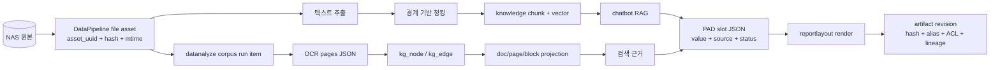

# 데이터 아키텍처

## 1. 원칙

데이터 아키텍처의 목표는 모든 서비스가 한 데이터베이스에 접속하는 것이 아니라, **각 데이터의 정본과 변경 권한을 명확히 하는 것**이다.

- 서비스는 자기 스키마와 API 계약을 소유한다.
- 다른 서비스의 테이블을 직접 읽는 경로는 예외이며 확장 패턴이 아니다.
- 원본, 파생 데이터, 검색 인덱스와 렌더 결과를 구분한다.
- 파생 데이터는 재생성 가능해야 하고 원본·처리 버전과 lineage를 가져야 한다.
- 사용자 접근 권한과 서비스 처리 권한을 따로 평가한다.
- 큰 binary와 구조화 메타데이터를 같은 저장 방식에 억지로 넣지 않는다.

## 2. 저장 기술과 책임

| 저장소 | 저장 대상 | 정본 여부 | 접근 방식 |
|---|---|---|---|
| PostgreSQL | 사용자·업무 상태, catalog, 실행 상태, KG 관계형 표현, artifact metadata | 업무 데이터의 정본 | 서비스별 schema/role와 API |
| pgvector | 사내 문서 지식 청크 임베딩 | 원문에서 재생성 가능한 검색 투영 | `chatbot` RAG API |
| Apache AGE | 그래프 탐색용 파생 표현 | 관계형 KG에서 파생 | 전용 query/API |
| NAS | 원본 문서, 템플릿, 큰 렌더 결과, 백업 | 원본 또는 binary 정본 | DSM API 또는 Resolver adapter |
| Redis | Portal 세션 | 짧은 수명의 인증 상태 | Portal만 직접 접근 |
| Resolver managed storage | 업로드 중·완료 artifact content | revision content의 정본 | upload/content API |
| PVC JSON | webcrawl 도메인 평판 등 로컬 운영 데이터 | 서비스 로컬 정본 | `webcrawl` API |

## 3. 논리 데이터 소유권

전체 시스템은 하나의 PostgreSQL 인스턴스를 공유할 수 있지만, 데이터는 다음과 같이 논리적으로 분리된다.

| 논리 영역 | 소유자 | 주요 엔터티 |
|---|---|---|
| 사용자·권한 | Portal | user, role, permission, department, NAS account link |
| 채팅·문서 | `chatbot` | session, message, run, document instance/version, field value, evidence |
| RAG | `chatbot` | knowledge chunk, embedding, approved knowledge |
| 자산 원장 | DataPipeline | scan run, file asset, history, scan root, exclude rule, RAG status |
| 규격 구조화 | `datanalyze` | corpus run item, OCR page JSON, kg node/edge, doc/page/block, missing document |
| 규칙 | `specrules` | code table, spec block/edge, screening table, quality defaults |
| 템플릿·렌더 | `reportlayout` | layout, golden, object, example, run, review |
| 실행 제어 | `orchestration-control` | action/intent/DAG catalog, request, execution, step, event |
| artifact | `artifact-resolver` | entity, revision, location, alias, relation, ACL, credential hash, event |

## 4. 문서 데이터의 계보



### 4.1 원본 자산

DataPipeline이 NAS를 스캔해 파일의 경로, 크기, 수정 시각, content hash, 소유자/부서와 상태를 자산 원장에 저장한다. 파일의 업무 식별자인 `asset_uuid`를 후속 `doc_id`로 재사용하면 재스캔·재청킹 시 문서 단위 교체가 가능하다.

자산에는 두 생명주기가 있다.

- 파일 생명주기: 발견, 등록, 변경, 이동, 누락, 복원, 격리
- RAG 생명주기: pending, embedded, skipped, failed

파일을 복원할 때 RAG 상태도 함께 초기화해야 한다. 이 둘을 하나의 status로 취급하면 복원된 파일이 재처리되지 않는 문제가 생긴다.

### 4.2 RAG 청크

추출 가능한 PDF/DOCX/XLSX에서 원문 텍스트를 가져온 뒤 LLM은 **청크 경계만** 제안한다. 텍스트 자체를 재작성하지 않는다. 연속 실패 시 문자 수 기반 결정적 fallback을 사용한다. 청크는 부서 ACL을 위한 `dept_code`와 원문 식별자를 포함하고, `chatbot`의 batch-upsert에서 같은 `doc_id`의 기존 청크를 원자적으로 교체한다.

### 4.3 규격 KG

`datanalyze`의 실제 write path는 다음 순서다.

```text
corpus_run_item(PENDING)
  → OCR/VLM
  → ocr_pages_json
  → KG build
  → kg_node/kg_edge
  → doc/page/block/block_ref projection
```

`kg_node/kg_edge`가 구조화 지식의 중심이고, 검색용 block과 AGE 그래프는 파생 표현이다. 오래된 `doc_queue` 상태머신은 코드가 존재해도 consumer가 없으므로 운영 정본으로 취급하지 않는다. AGE 동기화도 자동이 아니라 별도 스크립트 경로다.

### 4.4 PAD 슬롯과 evidence

슬롯은 단순 key/value가 아니다. 최소한 다음 메타데이터가 필요하다.

| 속성 | 의미 |
|---|---|
| `slot_id` | 템플릿과 독립적인 의미 식별자 |
| `value` | 정규화된 후보 또는 확정값 |
| `source_type` | USER_INPUT, RULE, DERIVED, EXTRACTED 등 |
| `evidence` | 문서/revision/page/block/rule row 식별자 |
| `status` | confirmed, unresolved, conflict, needs_review 등 |
| `step` | 값을 생산한 PAD STEP |
| `template_mapping` | 실제 템플릿에서의 필드 또는 합성 규칙 |

공통 슬롯은 세분화된 의미를 보존하고, 특정 템플릿이 더 거친 표현만 지원하면 렌더 시 합성한다. 템플릿에 없는 값은 슬롯 JSON에서 삭제하지 않고 생략 로그를 남긴다.

### 4.5 Artifact 모델

Resolver의 논리 구조는 다음과 같다.

```text
data_entity
  └─ artifact_revision (BUILDING → VALIDATING → READY)
       ├─ artifact_location
       ├─ artifact_alias (예: latest)
       ├─ artifact_acl
       ├─ artifact_relation (parent/child lineage)
       └─ artifact_event
```

content upload는 session 생성, streaming upload, hash/size 검증, commit 순서로 진행한다. commit 전 revision은 alias/content read에 노출되지 않는다. 같은 content hash를 여러 revision이 참조할 수 있으므로 GC는 마지막 참조 여부를 확인해야 한다.

## 5. Source of Truth와 파생 데이터

| 데이터 | 정본 | 파생/캐시 |
|---|---|---|
| 사내 문서 | NAS 파일 + 자산 원장 | 추출 텍스트, knowledge chunks, vector |
| 기술 규격 구조 | `kg_node/kg_edge`와 OCR artifact | block projection, AGE graph |
| PAD 업무 값 | 슬롯 JSON + evidence/status | 고객별 DOCX/PDF |
| 실행 상태 | Control request/execution/step | API summary, 외부 event subscriber |
| Artifact | revision metadata + committed content | alias, backend-specific index |
| 사용자 권한 | Portal 사용자/role/permission | 서비스가 받은 검증된 delegation context |

파생 데이터가 원본보다 먼저 수정되거나 별도 진실처럼 사용되지 않도록 한다.

## 6. 서비스 간 접근 규칙과 예외

기본 규칙은 “다른 서비스 데이터는 그 서비스 API를 통해 접근”이다. 전체 시스템 설명에서 확인된 직접 접근은 다음과 같은 과도기 예외다.

| 접근자 | 대상 | 목적 | 처리 방향 |
|---|---|---|---|
| DataPipeline | Portal 사용자/NAS 연결 정보 | 청크의 부서 결정 | 명시적 API/identity 계약으로 대체 |
| `datanalyze` | DataPipeline file asset | 규격 corpus seed | 안정된 read contract로 대체 |
| Portal 관리자 | 여러 schema | 운영 DB console | 강한 감사·최소권한 유지 |
| 백업 workload | 전체 DB/global role | 재해 복구 | 일반 서비스와 분리된 privileged workload |

새 기능이 편하다는 이유만으로 같은 예외를 추가하지 않는다.

## 7. ACL과 권한 전파

### 7.1 RAG ACL

지식 검색은 사용자의 부서와 일치하거나 공개 데이터인 청크만 반환한다. 원문 다운로드에서도 같은 조건을 다시 검사해야 한다. 검색 결과를 얻었다는 사실이 원문 다운로드 권한을 대신하지 않는다.

`dept_code`는 NAS의 전체 ACL을 실시간 복제한 것이 아니라 부서 단위 캐시이므로, 그룹·개별 ACL 변경의 지연과 한계를 운영자가 알아야 한다.

### 7.2 Artifact ACL

- 명시 ACL을 우선한다.
- 기본 scope가 선언되지 않은 artifact kind는 기본 거부한다.
- Resolver는 호출자가 보낸 임의 scope 문자열이 아니라 credential에 매핑된 실제 identity scope를 쓴다.
- lineage 조회에서도 각 ancestor/descendant를 독립적으로 필터한다.
- 권한 없는 artifact는 403으로 존재를 확인시켜 주기보다 404로 숨긴다.
- proxy identity만 `on_behalf_of`로 실제 생산 서비스를 대신할 수 있다.

### 7.3 Credential 저장

- credential 원문은 Secret 주입으로만 전달한다.
- DB에는 token hash와 정책만 저장한다.
- identity credential과 permission policy를 분리해 권한 변경이 secret 재발급을 강제하지 않게 한다.
- 로그, event payload, error response와 artifact metadata에 secret을 넣지 않는다.

## 8. 데이터 일관성과 멱등성

- NAS 재스캔은 mtime/size 불변이면 다운로드와 hash를 생략할 수 있다.
- RAG upsert는 `doc_id` 단위 전체 교체로 중간 버전 혼합을 막는다.
- Control은 caller와 payload fingerprint가 같은 `request_id`를 재실행하지 않는다.
- step retry는 성공 step을 보존하고 실패 step만 다시 실행한다.
- event는 dedup key와 ordering key를 가진다.
- artifact lineage의 멱등 키에는 execution ID를 포함해 동일 실행 retry와 서로 다른 실행의 provenance를 구분한다.
- alias 전환과 revision READY, lineage 기록은 가능한 한 한 transaction에서 처리한다.

## 9. Retention, 삭제와 복구

| 대상 | 정책 |
|---|---|
| NAS 원본 | 업무 보존 정책에 따르며 삭제는 자산 원장에 전파 |
| RAG 청크 | 원본 삭제 시 `delete-by-doc`, 복원 시 pending 재설정 |
| Artifact | deprecate → 승인된 physical delete; legal hold 우선 |
| 미완료 upload | lease/age 기준 sweep, 멱등 처리 |
| 실행 감사 | 설정된 retention window 동안 outbox/audit 보존 |
| DB 백업 | 별도 privileged job이 전체 DB와 globals를 저장하고 읽기 검증 |

백업 파일이 생성됐다는 사실과 실제 복구 가능성은 다르다. dump 목록 검증 외에 정기 restore drill이 필요하다.

## 10. 스키마·계약 변경 규칙

1. canonical 데이터와 파생 데이터를 문서에 표시한다.
2. 새 cross-schema SQL 대신 API 또는 Control Action을 정의한다.
3. 공유 state/evidence 타입 변경 시 DB writer, reader, admin API와 migration을 함께 검색한다.
4. enum/status 추가 시 producer와 모든 terminal-state consumer를 함께 수정한다.
5. 슬롯 추가 시 공통 schema, template mapping, validation, render test를 함께 갱신한다.
6. ACL 필드는 검색과 원문 다운로드 양쪽에서 테스트한다.
7. migration은 forward/rollback 또는 명시적 restore 전략을 가진다.
8. fixture와 sample을 운영 fallback 데이터로 사용하지 않는다.

## 11. 관련 코드와 문서

- PAD 공통 슬롯
- PAD state
- datanalyze corpus worker
- datanalyze KG build
- Control 실행과 이벤트
- Resolver
- [전체 아키텍처](01-architecture.md)
- [파이프라인과 스케줄링](08-pipelines-and-scheduling.md)
