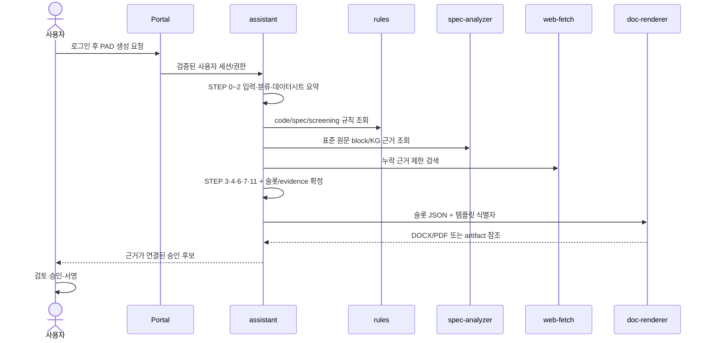

# 프로젝트 전체 개요

## 문서의 범위

PAD(Part Approval Document)를 자동 작성·검토하기 위한 멀티서비스 플랫폼의 전체 경계와 책임을 설명한다. 실제 코드와 내부 설계 설명을 대조해 작성했다. 충돌할 때는 다음 우선순위를 적용한다.

1. 실행 코드와 배포 정의
2. 테스트와 스키마
3. 서비스 README와 설계 문서
4. 과거 계획 또는 목표 아키텍처


## 무엇을 만드는 시스템인가

사용자나 배치가 부품·프로젝트 정보를 제공하면 시스템은 데이터시트, 기술 규격, 분류표와 내부 지식을 수집한다. LangGraph 기반 PAD 에이전트가 STEP 0–12의 결정적 절차로 공통 슬롯 JSON을 만들고, 렌더러가 프로젝트별 DOCX/PDF 템플릿에 값을 투영한다. 결과물은 값만 채운 문서가 아니라 각 필드의 출처, 판정 방식, 검증 상태와 lineage를 추적할 수 있는 승인 후보 문서다.

```text
사용자/BOM
  → 인증·세션·권한
  → PAD/채팅 에이전트
  → 규칙·표준·웹·사내 문서 근거 수집
  → 검증 가능한 공통 슬롯 JSON
  → 템플릿 검증·렌더링
  → 사람 검토·승인
```

## 시스템 경계

### 애플리케이션 서비스

| 서비스 | 책임 | 핵심 기술 |
|---|---|---|
| `assistant` | 사용자 대면 채팅, RAG, PAD STEP 그래프, HITL, 문서 상태 | FastAPI, LangGraph, Vue |
| `rules` | 코드표, 규격 적용성, 품질·screening 규칙 | FastAPI, PostgreSQL |
| `web-fetch` | 웹 검색·fetch, 유통사·제조사 조회, 도메인 평판 | FastAPI, 검색 공급자 adapter |
| `spec-analyzer` | 규격 PDF OCR, KG 구축, 근거 block 검색 | FastAPI, PostgreSQL, AGE, VLM/LLM |
| `doc-renderer` | 템플릿 계약, golden/example 관리, DOCX/PDF 렌더링 | FastAPI, Vue, Jinja/docxtpl 계열 |
| `control` | intent/action/DAG catalog, admission, 실행 상태·재시도·감사 | FastAPI, PostgreSQL outbox |
| `worker` | 승인된 HTTP action 실행, 계약 검증, 자격증명 격리 | Stateless FastAPI worker |
| `artifact-store` | artifact registry, ACL, lineage, upload lifecycle, storage adapter | FastAPI, PostgreSQL, managed storage |

### 공통 기반 구성 요소

| 구성 요소 | 전체 시스템의 역할 | 이 문서에서의 설명 범위 |
|---|---|---|
| Portal | 로그인·세션, 사용자/역할/permission, 서비스 진입점, 관리 프록시 | 인터페이스와 신뢰 경계만 설명 |
| DataPipeline | NAS 스캔, 자산 원장, 추출·청킹·임베딩, 백업 | 데이터·스케줄 흐름 |
| Model serving | language/reasoning/vision/embedding 모델 제공과 GPU 시간대 전환 | 소비 관계와 스케줄만 설명 |
| 공용 인프라 저장소 | PostgreSQL, Redis, NAS, 관측성, GitOps Application | 논리 아키텍처만 설명 |

이 구분은 중요하다. 애플리케이션 서비스만 보고 시스템 전체를 이해하면 인증 진입점, 사내 문서 수집, 모델 실행 계층과 운영 스케줄이 빠진다.

## 서비스별 핵심 책임

### 사용자·업무 계층

- Portal은 사람 인증의 기준이다. 브라우저 세션과 역할/permission을 검증하고 관리 화면을 각 서비스로 프록시한다.
- `assistant`은 업무 오케스트레이터다. 사용자 입력을 채팅, 기술 조사, 일반 문서, PAD 생성 흐름으로 라우팅한다.
- PAD 그래프는 LLM에게 최종 판정을 맡기지 않는다. 모델은 후보 생성·요약·추출에 제한하고, 분류 코드·규격 적용성·품질·screening은 catalog와 규칙으로 확정한다.
- 최종 승인과 서명은 사람의 책임으로 남는다.

### 지식·규칙 계층

- DataPipeline은 NAS 파일을 발견하고 RAG용 지식 청크로 변환한다.
- `spec-analyzer`는 기술 규격 PDF를 OCR하고 닫힌 온톨로지의 KG와 검색용 block으로 구조화한다.
- `rules`는 코드표와 검증된 규칙을 제공한다. 원문 근거 검색과 규칙 판정은 서로 다른 책임이다.
- `web-fetch`은 내부 근거가 부족할 때 제한된 외부 검색을 수행한다.

### 실행·데이터 계층

- Control은 호출자가 제출한 업무 intent를 action 또는 DAG로 해석하고, 실행 상태·재시도·취소·감사를 소유한다.
- Worker는 Control의 계획을 다시 검증하고 허용된 endpoint만 호출한다. 다운스트림 비밀은 Worker에 격리한다.
- Resolver는 논리 `artifact://` URI와 물리 저장 위치를 분리하고, revision·alias·ACL·lineage를 관리한다.
- `doc-renderer`은 슬롯 JSON을 템플릿 계약에 검증한 뒤 최종 문서로 렌더링한다.

## 대표 사용자 여정



Control Plane 전환이 적용된 경로에서는 `assistant → downstream` 직접 호출 대신 `assistant → Control → Worker → downstream/Resolver`가 된다. 현재 코드에는 기존 직접 호출과 신규 경로가 함께 존재하므로, 문서에서는 **현재 경로**와 **목표/전환 경로**를 구분한다.

## 핵심 설계 원칙

1. 값보다 근거와 lineage가 먼저다.
2. LLM은 후보·추출에 사용하고 결정은 코드와 승인된 데이터로 한다.
3. 의미 슬롯과 물리 템플릿을 분리한다.
4. 서비스는 다른 서비스의 저장소를 직접 읽지 않는 것을 기본으로 한다.
5. 상태 변경과 이벤트는 같은 트랜잭션에 기록한다.
6. 항목 단위 부분 실패, idempotency, checkpoint와 fencing을 기본값으로 한다.
7. 호출자·최종 사용자·다운스트림 자격증명을 분리한다.
8. 배포는 GitOps 경로를 따르고 비밀은 저장소에 넣지 않는다.
9. 데이터가 없으면 가짜 fallback을 만들지 않는다.
10. 사람 승인 지점을 자동화된 완료와 구분한다.

## 문서 지도

- [시스템 아키텍처](01-architecture.md) — 런타임, Control Plane, 이벤트, 보안, 배포 구조
- [데이터 아키텍처](07-data-architecture.md) — 데이터 소유권, 저장소, 모델, lineage, ACL
- [파이프라인과 스케줄링](08-pipelines-and-scheduling.md) — 수집·OCR/KG·RAG·PAD·렌더·운영 시간표
- [오케스트레이션](02-orchestration.md) — intent, DAG, idempotency, fan-in, fencing
- [에이전트](03-agent.md) — research loop, closed set, state 관리
- [PAD 파이프라인](06-pad-pipeline.md) — STEP 0–12와 슬롯 계약
- [AI 협업 개발 프로세스](04-ai-assisted-workflow.md) — task/memory 계층과 실행 순환
- [개발 작업 사례](05-example-task.md) — Control Plane 전환과 렌더링 버그 수정 사례
