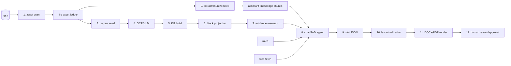
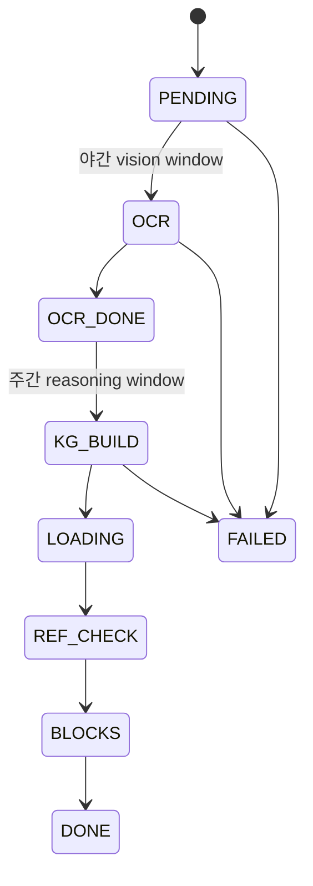
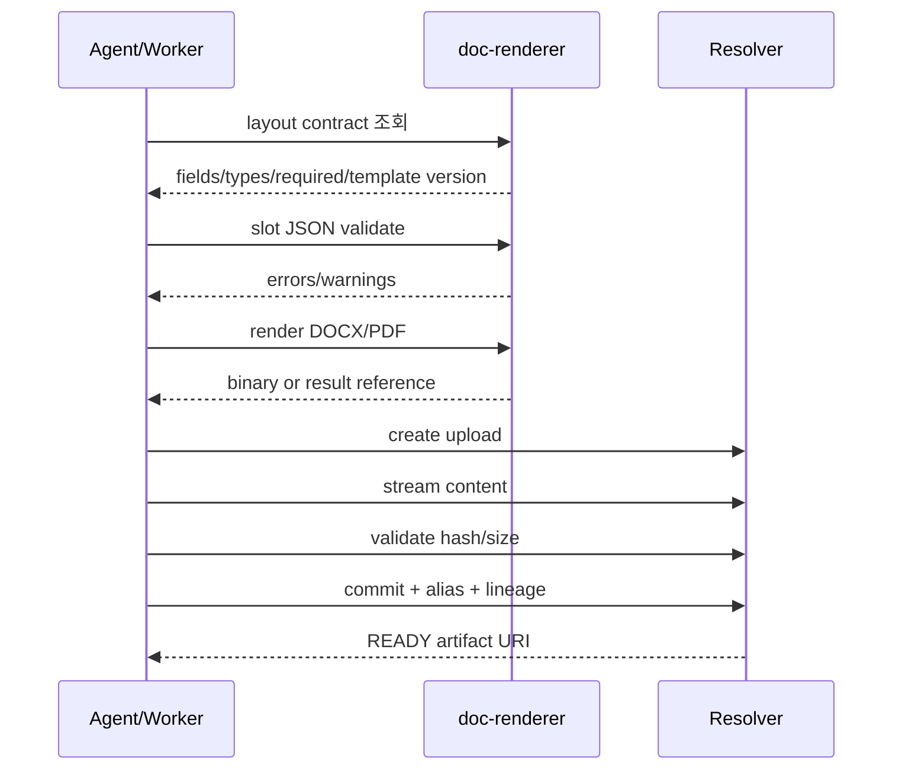

# 파이프라인과 스케줄링

## 1. 실행 모델

이 시스템의 작업은 세 가지 방식으로 실행된다.

| 방식 | 예 | 상태 소유 |
|---|---|---|
| 요청 기반 그래프 | 채팅, PAD 검색/작성, 렌더 요청 | `assistant` checkpoint/run |
| 정시 배치 | NAS scan/embed/retry/backup, GPU window 전환 | Kubernetes CronJob + DB |
| 상주 루프 | corpus worker, Control recovery/outbox/dead-letter, Resolver outbox | 각 서비스 DB와 lease |

“파이프라인”은 하나의 중앙 scheduler가 모든 작업을 호출한다는 뜻이 아니다. CronJob, DB queue, LangGraph와 Control DAG가 각자의 수명주기를 가지며 데이터 계약으로 연결된다.

## 2. 전체 데이터 처리 파이프라인



## 3. DataPipeline: NAS에서 RAG까지

DataPipeline은 전체 시스템에서 다음 계약을 담당한다.

### 3.1 Scan

1. 등록된 root를 파일 서버 API로 순회한다.
2. 제외 규칙과 업로드 중인 파일을 걸러낸다.
3. mtime과 size가 같으면 download/hash를 생략하고 `last_seen_at`만 갱신한다.
4. 변경 파일은 content hash와 소유자/부서 단서를 계산한다.
5. `file_asset`을 upsert하고 변경 history를 남긴다.
6. 이전 scan에는 있었지만 이번에 보이지 않는 파일은 missing/soft-delete로 표시한다.
7. 실패는 파일 단위로 기록하고 다음 파일을 계속 처리한다.

큰 파일은 비용을 제한하기 위해 부분 hash 정책을 사용할 수 있으므로, hash 방식도 provenance에 포함해야 한다.

### 3.2 Extract, Chunk, Embed

1. 삭제된 embedded 자산을 먼저 `assistant`의 `delete-by-doc` 계약으로 전파한다.
2. `rag_status=PENDING`인 자산을 제한된 batch로 가져온다.
3. 지원 형식에서 텍스트를 추출한다.
4. LLM은 원문을 재작성하지 않고 청크 경계만 제안한다.
5. 실패하면 결정적 문자 수 fallback을 적용한다.
6. 부서 ACL tag와 원문 locator를 붙인다.
7. `batch-upsert`로 같은 `doc_id`의 모든 청크를 교체한다.
8. 자산별로 embedded/skipped/failed 상태를 갱신한다.

### 3.3 Delete와 Restore

NAS에서 사라진 파일은 원장과 RAG 양쪽에서 삭제 상태를 전파한다. 파일이 돌아오면 파일 status뿐 아니라 `rag_status`도 pending으로 돌려 재임베딩해야 한다. 이 두 상태를 따로 관리하지 않으면 복원된 문서가 검색에서 영구 누락될 수 있다.

## 4. DataAnalyze: 규격 PDF에서 근거 block까지

현재 코드 기준 canonical 실행은 `corpus_run_item`을 소비하는 단일 worker다.



### 4.1 야간 OCR/VLM

- 원본 PDF를 NAS에서 가져온다.
- 텍스트·좌표 추출과 OCR triage를 수행한다.
- 필요한 페이지를 vision model에 보낸다.
- page별 결과를 OCR JSON artifact에 저장한다.
- 문서 하나의 실패는 다른 corpus item 진행을 막지 않는다.

### 4.2 주간 KG와 Block

- OCR 결과에서 닫힌 온톨로지의 node/edge를 추출한다.
- `kg_node/kg_edge`를 갱신한다.
- 참조 표준을 발견하면 missing document queue에 등록한다.
- KG를 `doc/page/block/block_ref` 검색 모델로 투영한다.
- `assistant`은 requirement block 검색 API를 근거 수집에 사용한다.

AGE graph는 자동 정본이 아니라 별도 동기화 작업으로 만드는 파생 표현이다.

### 4.3 Missing document

KG build가 참조했지만 corpus에 없는 규격은 queue에 들어간다. worker는 backoff가 지난 항목을 제한된 수만큼 조회하고 `web-fetch`로 다시 찾는다. 무한 검색을 피하기 위해 attempt, next retry와 terminal policy가 필요하다.

## 5. Research와 PAD 파이프라인

### 5.1 Evidence research

질문을 task로 분해하고 다음 우선순위로 근거를 찾는다.

1. 승인된 내부 규칙과 구조화 표준
2. RAG 지식 청크와 KG block
3. 공식/등록 문서
4. 제한된 외부 검색

표준이 다른 규격을 참조하면 evidence tree가 교차참조를 따라가되 깊이와 round 상한을 적용한다. 가짜 relevance score를 만들지 않고 실제 similarity가 없는 근거는 별도 정책으로 다룬다.

### 5.2 PAD

```text
검색 그래프:
layout_field → pad_defaults → step0 → step1 → step2 → evidence_tree

작성 그래프:
step3 → step4 → step6 → step7 → step11 → layout_build
```

두 그래프는 동일 checkpoint namespace와 `thread_id`를 사용한다. STEP 5와 8–10은 신뢰 원천과 규칙이 확정될 때까지 미확정 상태를 유지하고, STEP 12는 사람 승인이다. 자세한 내용은 [06-pad-pipeline.md](06-pad-pipeline.md)를 참고한다.

## 6. Render와 Artifact 파이프라인



템플릿 validation과 artifact commit은 별개 경계다. 렌더에 성공해도 upload/commit이 실패하면 artifact가 READY가 아니며 호출자에게 완료로 노출하면 안 된다.

## 7. Control DAG 실행

Control은 action과 DAG를 catalog에서 읽고 입력 schema와 권한을 검사한다.

1. `request_id`와 payload fingerprint로 request를 claim한다.
2. intent 또는 명시적 DAG/action을 versioned contract로 해석한다.
3. dependency가 충족된 step을 병렬 실행한다.
4. Worker가 endpoint, path, schema, digest와 credential 존재를 재검증한다.
5. 결과를 inline 또는 Resolver artifact로 저장한다.
6. 상태와 event를 같은 transaction에서 commit한다.
7. 실패 step만 retry하며 성공 result는 checkpoint로 재사용한다.
8. 취소 시 intent를 먼저 DB에 기록하고 claim epoch로 늦은 결과를 차단한다.

## 8. 정기 스케줄

### 8.1 실행 주기 요약

| 작업 | 주기 | 역할 |
|---|---|---|
| 자산 scan | 매시 | 파일 서버 변경 탐지와 자산 원장 갱신 |
| 추출·청킹·임베딩 | 매시 | 삭제 전파, 추출·청킹·임베딩 |
| 실패 자산 재시도 | 매시 | 실패한 자산 재처리 |
| DB 백업 | 일 1회 | 전체 DB 보존 |
| 비전 처리 윈도우 | 야간 | vision serving 전환과 OCR |
| 추론 윈도우 | 주간 | reasoning 모델과 KG/block 처리 |

야간 GPU 전환과 백업은 서로 다른 자원을 주로 쓰지만, 파일 서버·DB·노드 I/O 경합 여부를 관측해야 한다.

### 8.2 스케줄 정책

- 시간대를 명시하고, 중복이 안전하지 않은 작업은 동시 실행을 금지한다.
- 실행 제한 시간은 다음 주기를 침범하지 않게 정한다.
- 재시도 횟수와 이력 보존 수를 명시한다.

## 9. 상주 background loop

| 서비스 | loop | 기본 주기/조건 | 책임 |
|---|---|---|---|
| `spec-analyzer` | corpus worker | poll 기반 단일 worker | 시간대에 따라 OCR 또는 KG/block 처리 |
| Control | recovery | 단주기 | lease 만료 step과 진행 중 execution 복구 |
| Control | outbox | 단주기 | pending execution/request event claim·발행 |
| Control | dead-letter | opt-in | 자동 retry |
| Resolver | outbox | 설정 주기 | artifact event 발행 |
| `assistant` | request background task | 사용자 요청마다 | 그래프 실행과 SSE event 생산 |

## 10. 스케줄 설계 규칙

1. `timeZone: Asia/Seoul`을 명시하고 schedule은 KST 벽시계 값으로 쓴다.
2. 중복이 안전하지 않은 작업은 `concurrencyPolicy: Forbid`를 사용한다.
3. `activeDeadlineSeconds`는 다음 실행을 침범하지 않도록 정한다.
4. retry는 Job 재시도와 다음 주기 재처리를 구분한다.
5. Pod label은 NetworkPolicy selector와 일치해야 한다.
6. batch는 항목 단위로 실패를 격리하고 재실행에 멱등이어야 한다.
7. GPU window는 CronJob과 worker의 시간 판정 설정을 함께 변경한다.
8. 새 스케줄은 GitOps deploy 정의와 이 문서의 시간표를 동시에 수정한다.
9. 백업·OCR·embedding의 NAS/DB/GPU 자원 경합을 검토한다.
10. 자동화되지 않은 sweep/동기화가 있으면 owner, cadence와 alert를 명시한다.

## 11. 운영 점검 목록

### 매일

- VLM start/stop Job이 성공했는가
- corpus item이 PENDING/OCR_DONE에 비정상적으로 누적되는가
- outbox publish attempt와 lease 만료가 증가하는가
- RAG pending/failed와 missing document queue가 증가하는가
- DB backup이 생성·검증됐는가

### 변경 시

- schedule과 worker 내부 시간대가 일치하는가
- deadline 안에 batch 크기가 처리 가능한가
- NetworkPolicy label과 egress가 맞는가
- 상태 복원 시 연계 status가 함께 reset되는가
- action schema/digest와 Worker local spec이 같이 배포되는가
- 새 artifact가 retention/ACL/default-deny 정책을 가지는가
