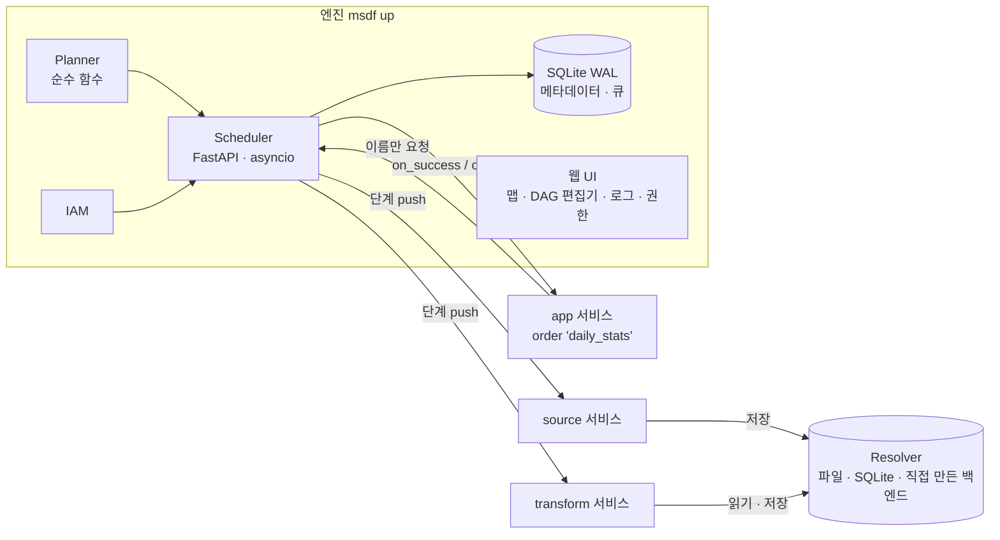

# 아키텍처

## 1. 엔진과 서비스



- **데이터는 엔진을 거치지 않습니다.** 서비스가 Resolver로 직접 읽고 쓰고, 엔진은 메타데이터(무엇이 언제 어디서 왜 만들어졌나)만 가집니다.
- **DB에 쓰는 것은 엔진의 전용 스레드 하나뿐입니다.** 서비스가 큐를 읽지 않고 엔진이 쉬는 인스턴스에 단계를 밀어 주므로 SQLite 동시 쓰기 문제가 없습니다.
- 서비스는 `start()` 한 줄로 붙습니다. 심박이 끊기면 lease가 만료돼 그 단계는 다른 인스턴스에서 다시 실행됩니다.

## 2. 사용자가 쓰는 것

```python
service("transform")                                  # 선언 (0.2부터 함수 없이 한 줄)

@action(inputs=["rows"], outputs=["clean"], retries=2)
def clean(rows):
    return [r for r in rows if r["value"] is not None]
```

```yaml
order: daily_stats            # 요청하는 쪽이 아는 것은 이 이름뿐
nodes:
  load:  {service: source,    action: load, fresh_for: 1h}
  clean: {service: transform, action: clean}
edges:
  - {from: load.rows, to: clean.rows}
result: clean.clean
deliveries:
  - {requester: app, on_success: app.on_stats, on_fail: app.on_stats_failed}
```

함수 여섯 개(`service`, `action`, `order`, `start`, `context`, `delete`)와 YAML 세 개(DAG, IAM, resolvers)가 전부가 되도록 유지합니다.

## 3. 데이터 ID

```
step_key    = hash(서비스, Action, 버전, 슬롯별 입력 artifact_id, 루트 params)
lineage_key = hash(step_key, 출력 슬롯)            ← "요청의 정체"
artifact_id = hash(부모 artifact_id들, lineage_key, generation)
```

- Planner는 실행 **전에** artifact_id를 계산(`planned_id`)하고, Resolver는 저장 **후에** 같은 함수로 발급합니다. 둘이 다르면 캐시가 전부 어긋나므로 가장 먼저 테스트로 고정했습니다.
- 같은 `step_key`가 이미 hot에 있으면 그 단계는 건너뛰고(캐시), 진행 중이면 합류합니다(계산 한 번, 배달은 요청 수만큼).

## 4. 요청 하나의 흐름

```
order("daily_stats", {"day": ...})
  → IAM 검사 (order 권한 + 캐시로 건너뛸 단계를 포함한 모든 flow 엣지)
  → Planner: 결과에 필요한 단계만, 캐시 · 진행 중 단계 제외
  → Scheduler: 의존이 끝난 단계를 쉬는 인스턴스에 push (lease)
  → 서비스: Resolver로 입력 읽기 → Action 실행 → 출력 저장 → 결과 보고
  → 실패: retries만큼 재시도 → 그래도 실패면 의존 단계 cancelled, 요청 서비스의 on_fail
  → 성공: 요청 서비스의 on_success로 결과 배달
```

## 5. 로딩할 때 검사하는 것

코드는 **실행하지 않고 ast로 읽습니다.** 서비스 파일에서 import를 따라가 닿는 Action을 그 서비스 것으로 판정하고,
DAG가 가리키는 Action · 슬롯이 실제로 있는지, IAM 규칙이 정의된 계층만 쓰는지를 `msdf check` 한 번에 모두 알려 줍니다(파일 · 줄 · 원문 · 고칠 방법).

---

- 이전 문서: [프로젝트 개요](00-overview.md)
