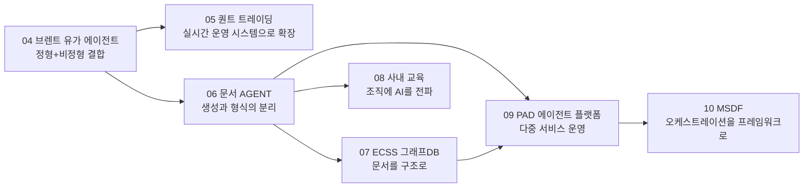

# 이재휘 개발 일지

> **물리학 → 광학 엔지니어 → AI Agent Engineer**
> 현장의 반복 업무를 데이터로 정의하고, LLM 에이전트와 데이터 파이프라인으로 자동화합니다.

이 저장소는 제가 직접 겪은 문제와, 그 문제를 풀면서 **배운 것**을 프로젝트 단위로 정리한 개발 일지입니다.
모든 경험 문서는 같은 틀로 작성했습니다.

```
상황(Context) → 문제(Problem) → 시도와 실패(Try) → 해결(Solution) → 결과(Result) → 배운 점(Lesson)
```

각 프로젝트는 **프로젝트 문서(`docs/`)** 와 **경험 문서**로 구성됩니다.

---

## 한눈에 보기

| # | 프로젝트 | 기간 · 형태 | 핵심 키워드 | 대표 성과 |
|---|---|---|---|---|
| 04 | [브렌트 유가 예측 AI 에이전트](./04_브렌트유가_예측_AI에이전트) | SKALA · 6인 2개월 | LangGraph, Event Study, 듀얼 스토리지 | 방향성 정확도 **약 10%p 개선** |
| 05 | [AI 하이브리드 퀀트 트레이딩](./05_AI_하이브리드_퀀트트레이딩) | 2026.06~ · 1인 개발 | 3-Layer, 로컬 LLM, ReAct, asyncio | WebSocket 장애 **-90%**, 파싱 성공률 **20% → 90%+** |
| 06 | [문서 형식 유지 작성 AGENT](./06_문서형식유지_작성AGENT) | 2026.07~ · 단독 | Content/Layout 분리, docx 템플릿 | 실제 PAD·계약서 양식 보존 |
| 07 | [ECSS 규격 그래프DB 파이프라인](./07_ECSS규격_그래프DB_파이프라인) | 2026.07~ · 단독 | Atomic Block, 스키마 진화, Graph RAG | 388 Block 추출, 641 canonical record |
| 08 | [사내 프롬프트 엔지니어링 교육](./08_사내_프롬프트엔지니어링_교육) | 2026 · 단독 기획·발표 | CoT, ReAct, MCP, Skill | 전 직원 대상 세미나 진행 |
| 09 | [PAD 에이전트 플랫폼](./09_PAD_에이전트_플랫폼) | 2026.09~ · 1인 개발 (AI 코딩 에이전트 협업) | 결정적 단계 파이프라인, Outbox·Fencing, Artifact Resolver, GitOps | 단일 에이전트 → 다중 서비스 운영 플랫폼으로 확장 |
| 10 | [MSDF 데이터 중심 서비스 연결 프레임워크](./10_MSDF_데이터중심_서비스연결_프레임워크) | 2026.11~ · 개인 오픈소스 (AI 코딩 에이전트 협업) | 데이터 중심 DAG, 결정적 ID 캐시, ast 정적 분석, IAM, Vue Flow | [오픈소스 공개](https://github.com/funpinbo/MSDF) 0.1 → 0.2, 테스트 139개 |

---

## 지금 공부하고 있는 것

실무에서 생긴 질문을 블로그에 글로 풀어 쓰며 공부하고 있습니다. → **[blog.jimmy-home.com/?user=jaehwi](https://blog.jimmy-home.com/?user=jaehwi)** · 정리: [00. 공부 기록](./00_공부_기록)

| 주제 | 내용 | 진행 |
|---|---|---|
| [내 컴퓨터로 AGENT 개발하기](./00_공부_기록/01_내_컴퓨터로_AGENT_개발하기) | LLM 원리 → 하드웨어 · 서빙 → Agent · LangGraph → RAG · MCP → 시스템 설계까지 7편 연재 | 1편 완료, 2편 작성 중 |
| [논문 리뷰](./00_공부_기록/02_논문_리뷰) | 연재의 각 편에 필요한 논문을 풀어 읽기 | PagedAttention(vLLM) 3편 완료, CoALA 작성 중 |
| [AWS MLA](./00_공부_기록/03_AWS_MLA) | 로컬에서 하던 LLM 파이프라인을 클라우드에서는 어떻게 하는지. 2026.12.23 시험 목표 | 데이터 형식, 저장소 |

---

## 프로젝트가 이어지는 흐름

각 프로젝트는 따로 떨어진 경험이 아니라, 앞 프로젝트에서 얻은 질문이 다음 프로젝트의 출발점이 되었습니다.



---

## 경험에서 얻은 엔지니어링 원칙

| 원칙 | 처음 배운 곳 | 다시 적용한 곳 |
|---|---|---|
| **같은 방법을 반복하기 전에 원인을 다시 정의한다** | 05 LoRA 실패 → RAG 전환 | 06 문서 재생성 → 템플릿 |
| **결정적인 부분과 비결정적인 부분을 분리한다** | 06 Content / Layout 분리 | 07 원문(atomic) / 정규화(normalized) 분리 |
| **LLM 출력을 그대로 믿지 않는다** | 04 Hallucination 회고 | 07 `confidence`·`requires_review` 스키마 |
| **근거를 추적할 수 있게 저장한다** | 04 FAISS + PostgreSQL 듀얼 스토리지 | 07 `source_region_id` 역추적 |
| **외부 시스템의 제약을 먼저 확인한다** | 05 KIS WebSocket 단일 연결 제약 | 05 502 토큰 만료 대응 |
| **LLM은 판정하지 않고, 텍스트를 다시 쓰지 않는다** | 06 Content / Layout 분리 | 09 결정적 단계 파이프라인, 경계만 판단하는 청킹 |
| **재시도는 상태를 바꿀 때만, 실패한 것만** | 05 502 토큰 강제 갱신 | 09 실패 step만 재시도, epoch fencing |
| **사고는 규칙과 검사기로 남긴다** | 09 타임존 · 라벨 누락 사고 | 09 CronJob 표준 린터 |
| **큰 전환은 관찰부터, 안전망은 따로 걷어낸다** | 09 Control Plane shadow 모드 | 09 strict 전환 운영 사고 → 회귀 테스트 |
| **"없음"을 가짜 값으로 표현하지 않는다** | 09 가짜 유사도 1.0 | 09 턴 시작 state 리셋 |
| **흐름의 기준을 task가 아닌 데이터로 둔다** | 09 Artifact Resolver | 10 결과물 이름만 요청하는 `order()` |
| **식별자를 잘 정하면 기능이 따라온다** | 10 결정적 데이터 ID | 10 캐시 · 부분 재계산 · 중복 제거 · 계보 |

---

## 기술 스택

| 분야 | 사용 기술 |
|---|---|
| Language | Python 3.10+ (asyncio, mypy strict, Pydantic v2) |
| LLM / Agent | LangGraph, ReAct, Ollama(KANANA 1.5 8B), Gemini 2.5 Flash, qwen 계열, GPT-OSS-120B, LoRA |
| Retrieval | FAISS, BM25, Elasticsearch(Nori), RRF, Embedding 클러스터링 |
| Data / DB | PostgreSQL(스키마 격리), SQLite(WAL), TimescaleDB, pgvector, Apache AGE(Graph), Redis, JSON Schema |
| ML / DL | CatBoost, PatchTST, BSTS(orbit-ml), LoRA |
| Frontend | Vue 3, Vue Flow, Server-Sent Events |
| Infra / API | FastAPI, APScheduler, WebSocket, KIS / Naver / FRED API, Kubernetes, Jenkins, ArgoCD(GitOps), Sealed Secrets |
| Model Serving | vLLM 기반 로컬 모델 서빙 (오픈 웨이트 LLM · VLM · OCR · 임베딩 모델) |
| Observability | Loki, Prometheus, Grafana Alloy, Arize Phoenix(OTel) |
| Docs | python-docx, Jinja 스타일 템플릿, OnlyOffice |

---

## 폴더 구조

```
leejaehwi-story/
├── README.md                          ← 지금 보고 있는 인덱스
├── 00_공부_기록/                       ← 블로그에 쓰는 공부 글의 정리와 링크
└── {번호}_{프로젝트}/
    ├── README.md                      ← 프로젝트 인덱스 (문서 목록 · 경험 목록)
    ├── docs/                          ← 프로젝트 문서
    │   ├── 00-overview.md             ← 배경 · 문제 · 성과 · 회고
    │   └── 01-architecture.md         ← 아키텍처 (09는 시스템 · 데이터 · 오케스트레이션 등 9편)
    └── {번호}_{경험}/
        └── README.md                  ← 경험 문서 (문제 → 해결 → 배운 점)
```
